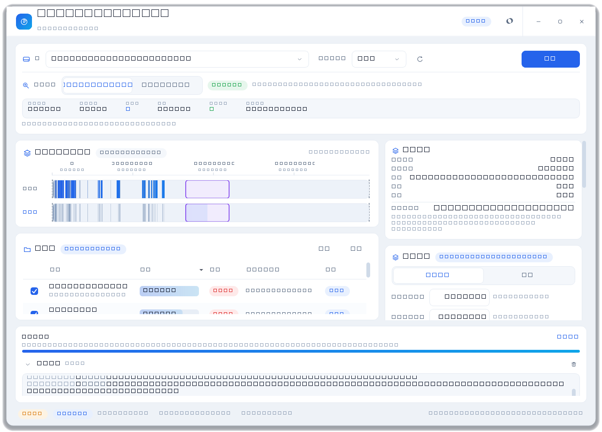
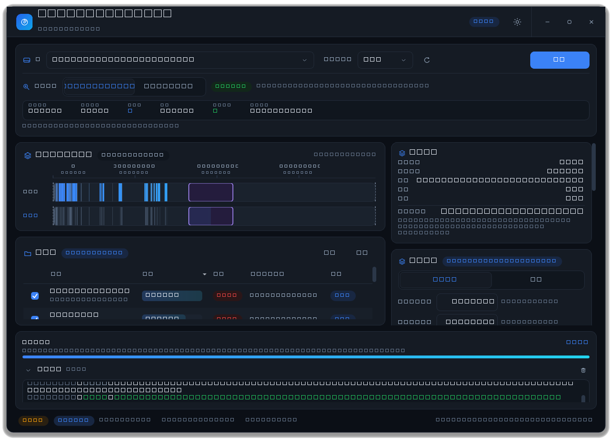

# LBA Tail Mover —— 大文件末端 LBA 迁移工具

把卷上的**大文件**移动到该卷**末端的 LBA（逻辑块地址）区间**，从而在卷前部腾出
**连续可用空间**（典型用途：为分区缩容、为新的连续分区预留空间做准备）。

* 平台：Windows 10 / 11（x64）
* 运行时：Python 3.11+，界面 **PySide6**（唯一第三方依赖）
* 全部 Win32 调用通过标准库 `ctypes` 完成，**不依赖 pywin32**

> **关于代码来源**
>
> 本项目代码由 **AI 助手生成**（vibe coding），维护者**不具备代码审查能力**，
> 不对其正确性、安全性或对数据的影响作任何保证。请自行阅读、验证后再使用，后果自负。

> # ⚠️ 高危操作警告 — 使用前必读
>
> **本工具会直接改写 NTFS 卷上的簇分配（调用 `FSCTL_MOVE_FILE`），属于高危磁盘操作。**
> 使用不当**可能导致文件损坏、数据丢失，甚至整卷暂时无法挂载**。
>
> * **务必先完整备份**目标卷上的所有重要数据，并确认备份可恢复；
> * 执行期间**严禁断电、重启、蓝屏或强制结束程序**；
> * **绝不要**在没有备份 / 唯一副本的数据上运行；
> * 首次使用请先在**非系统数据卷**上用可丢弃的文件试运行，确认无误后再用于真实数据；
> * **作者不对任何数据丢失或损坏负责**，继续使用即表示你已理解并自担全部风险。
>
> 详细风险、预防措施与工具的保护边界见下方「三、风险声明与安全须知」。



> 📖 **原理与深入说明**（架构分层、Win32 契约、介质探测、安全模型、规划算法、
> v2 引擎实测、N1–N5 功能原理、1.0.0C 密实化 / 分块流式策略）见
> **[manual_Datasheet.md](manual_Datasheet.md)**；版本变更见
> **[CHANGELOG.md](CHANGELOG.md)**。本 README 只讲上手与操作。

---

## 一、运行方式

```bat
:: 方式 1：双击 run.bat（会提示当前是否为管理员）
run.bat

:: 方式 2：命令行
pip install -r requirements.txt
python main.py
```

### 管理员权限（重要）

| 能力 | 普通用户 | 管理员 |
| --- | --- | --- |
| 枚举卷 / 读取卷标与容量 | ✅ | ✅ |
| 读取 NTFS 卷结构（簇大小、总簇数、MFT 区） | ❌ | ✅ |
| 读取卷位图（`FSCTL_GET_VOLUME_BITMAP`） | ❌ | ✅ |
| 扫描文件 + 解析物理布局（retrieval pointers） | ✅ | ✅ |
| 规划与「迁移前后」布局对比 | ✅（需位图） | ✅ |
| **真实移动簇**（`FSCTL_MOVE_FILE`） | ❌ 禁用 | ✅ |

> 打开 `\\.\C:` 这类卷设备句柄需要管理员权限。非管理员启动时程序进入
> **只读模式**：界面左下角显示 `只读模式` 徽章，执行按钮禁用，并在右侧面板给出
> 明确中文提示。
>
> 真实移动还额外要求 `SeManageVolumePrivilege`（`SE_MANAGE_VOLUME_NAME`）特权，
> 程序在启动时用 `AdjustTokenPrivileges` 提升；失败会直接显示原因。

---

## 二、双模式（预览 / 执行）

| 模式 | 行为 | 是否写盘 |
| --- | --- | --- |
| **预览模式**（默认） | 扫描 → 规划 → 「迁移前 / 迁移后」布局对比 | **绝不写盘** |
| **执行模式** | 二次确认后逐 extent 调用 `FSCTL_MOVE_FILE` | 真实写盘 |

代码层面的隔离措施：唯一的写操作模块 `app/win32/mover.py` 只在
`MoveWorker.run()` 内部**按需导入**，因此「预览模式」这条代码路径上不存在任何
写操作调用点（细节见 manual_Datasheet.md §1）。



---

## 三、风险声明与安全须知（务必阅读）

> **本工具会直接改写磁盘上的簇分配，属于高危操作。请务必在理解以下内容后使用。**

### 3.1 可能发生的严重后果

* **数据损坏 / 丢失**：迁移过程中若**断电、蓝屏、系统崩溃、硬盘掉线或被强制结束**，
  正在搬运的簇可能处于半完成状态，导致文件内容错乱或卷结构不一致。
  NTFS 自身的事务日志有助于恢复**单次**移动，但**不保证整个迁移计划序列**，
  更不替代你的事前备份；
* **不可逆**：迁移完成后文件的**物理布局**已改变。工具**不提供**「一键还原到
  原物理布局」的能力——所谓「回滚」只是按日志把簇搬回，不等于恢复原状；
* **卷级风险**：极端情况下卷可能无法正常挂载，需要 `chkdsk /f` 甚至 `/r` 修复，
  而修复过程本身也有进一步损坏的风险；
* **误伤风险**：若目标区间判断失误、位图过期、或被其它程序并发写入干扰，
  可能波及**未被选中**的文件；
* **性能与稳定性**：大卷 / 大量文件的迁移会长时间高负载占用磁盘，期间系统
  其它操作可能明显变慢。

### 3.2 使用前的强制预防措施

1. **完整备份**：对目标卷做一次**可验证**的完整备份；没有可用备份就不要执行迁移；
2. **稳定环境**：笔记本接好电源并关闭休眠 / 睡眠，台式机建议接 UPS；
3. **停止写入**：执行期间尽量不要在该卷上安装软件、下载、编辑或保存文档；
4. **避开冲突程序**：实时杀毒、备份 / 同步客户端等可能打开目标文件或争用磁盘，
   建议临时退出；
5. **先小范围试跑**：首次使用请在一个**非系统数据卷**上、用**可丢弃**的文件试运行，
   确认行为符合预期后再用于真实数据；
6. **确保卷健康**：迁移前先对该卷做一次 `chkdsk <盘符>: /scan`，确认无文件系统错误；
7. **留在现场**：迁移期间不要离开到无法处理异常提示的程度。

### 3.3 工具内置的保护（重要，但**不能替代备份**）

1. 执行前弹出**自定义危险确认对话框**：红色警示 + 逐条列出将移动的文件名与字节数
   + 必须勾选「我已知晓风险」后确认按钮才可用；
2. 每个 extent 移动前用位图**逐簇校验**目标区间确实空闲；
3. 三重几何禁区（卷首 / 卷尾 / MFT 保留区）+ 对象禁区（`$` 元数据 / 压缩 / EFS /
   无物理分配）；分区表在卷之外，物理上不可达（安全模型细节见 manual_Datasheet.md §4）；
4. 只允许**同卷内**移动，执行前再次校验源文件属于当前卷根；
5. 任何失败都记录完整上下文（文件、源 / 目标 LCN、簇数、Win32 错误码与文本），
   不吞异常；支持在 extent 之间安全取消（不把单个 extent 撕裂成两半）；
6. JSONL 流水日志逐段落盘，便于事后审计与手动回滚。

### 3.4 工具**不**保护的情况（请自负其责）

* 执行期间**强制断电 / 拔盘 / 按复位键 / `kill -9`**；
* 目标卷本身已存在文件系统错误或硬件故障（坏道、控制器掉盘等）；
* 迁移后想「回到原来的物理布局」（工具只按新计划搬运，不还原原布局）；
* 在有大量并发写入、或磁盘健康状况不明时执行。

**完成迁移后**，建议对该卷运行一次 `chkdsk <盘符>: /f`（只读检查用 `/scan`）
以确认文件系统一致性。

> **免责声明**：作者不对因使用本工具造成的任何数据丢失、损坏、业务中断或
> 其它直接 / 间接损失承担任何责任。使用本工具即表示你已完整阅读并理解上述
> 风险，并同意自担全部风险。


---

## 四、界面说明

```
┌ 标题栏：标识 / 工作模式切换（LBA 迁移 · 分块流式）/ 模式徽章 / 主题 / 窗口按钮 ┐
├ 工具条：卷选择 · 大文件阈值 · 重新读取位图 · 扫描（含 MFT/句柄通道）        ┤
├──────────────┬──────────────────────────┤
│ 卷 LBA 布局图 │ 侧栏（随工作模式切换）：                              │
│ 大文件列表    │  · LBA 迁移：摘要 / 目标区间+策略+可行性+挡路者+保留区  │
│              │                / IO 加速 / 执行与恢复 / 模式与操作        │
│              │  · 分块流式：缓存(内存·硬盘) / 缓冲倍数 / 开始        │
├──────────────┴──────────────────────────┤
│ 进度条 + 折叠式操作日志                                     │
│ 状态栏：权限徽章 · 介质 · 簇大小 · 总簇数 · 可用空间 · 文件系统 │
└─────────────────────────────────────────┘
```

* **顶栏「工作模式」切换**：`LBA 迁移`（簇级精确搬运）与 `分块流式`（同卷内「前端→卷尾」的
  用户态分块拷贝）两种工作模式，切换即换右侧栏，**左侧布局图 + 文件表作为主 UI 全程不变**。
  分块流式先预填充一段连续簇，再流式读出+内存缓存+流式覆盖，原理见 manual_Datasheet.md §8.5。
* **卷 LBA 布局图**（自绘）：横向条带按 LCN 递增；`迁移前 / 迁移后` 两条带对比；
  可**直接拖选设定目标区间**（与右侧双向同步）；悬停显示 LCN、偏移、状态与所属文件。
* **大文件列表**：复选框 / 文件名+完整路径 / 大小占比条 / 碎片数徽章 / LCN 区间 / 状态；
  「前半·候选」标注占卷前半的大文件（应搬末端者）。支持表头排序、全选、反选。
* **规划策略**（LBA 迁移模式，目标区间面板）：区间装箱 / 自动填满末端 / 区间预密实化 /
  按大小分区——各策略原理见 manual_Datasheet.md §8。
* **键盘**：`Ctrl+R` 重新扫描、`Ctrl+E` 执行主操作、`Esc` 取消当前操作、
  `Ctrl+L` 折叠 / 展开日志。
* 所有耗时操作都在 `QThread` 中执行，UI 不阻塞。

---

## 五、已知限制

1. **仅支持 NTFS**：位图与 retrieval pointers 依赖 NTFS 的 FSCTL；FAT/exFAT 卷
   会提示不可用。
2. **需要管理员权限才能读取位图**：非管理员时只能看到卷标与容量，无法规划。
3. **不支持加密文件（EFS）与重解析点 / 符号链接**：扫描阶段跳过 reparse point，
   避免目录循环。
4. **压缩文件（WOF / LZX）**：`FSCTL_MOVE_FILE` 对压缩单元有额外约束，工具会
   在失败时记录完整错误并跳过该段，不会静默损坏。
5. **位图超过 512 MiB（约 40 亿簇）的卷**会被拒绝读取，以避免内存耗尽。
6. 一个文件移动失败时，同一文件的其余 extent 仍会继续尝试（逐段独立），因此
   可能出现「部分搬移」的状态；失败详情会完整记录在日志中。
7. 单实例限制通过命名互斥体实现；关闭过程中若移动线程未能在 1.5 s 内退出会被
   强制放弃等待（`wait` 超时），此时请勿重复启动。
8. **分块流式模式**为同卷内「前端→卷尾」的用户态拷贝（预填充连续簇 + 流式读出缓存 + 流式覆盖），
   落点 LBA 由文件系统在空闲区分配（保证连续、不保证精确 LCN）；删源为「移入回收站、可恢复」，
   见 manual_Datasheet.md §8.5。

---

## 六、开发期截图脚本

```bat
python tools/preview_shots.py
```

该脚本**只读**运行：真实枚举卷、读取位图、解析真实文件的物理布局，用真实规划算法
生成示例计划，然后把界面渲染到 `docs/screenshots/`。它**不会**调用 `FSCTL_MOVE_FILE`。

---

## 七、打包为单文件 EXE

`dist/LBA-Tail-Mover.exe` 是**单文件、无控制台、默认请求管理员（UAC）**的 Windows x64
程序：双击即用，目标机器**无需安装 Python / PySide6**（约 45 MB）。

```bat
pip install pyinstaller
python -m PyInstaller --clean --noconfirm LBA-Tail-Mover.spec
```

产物：`dist/LBA-Tail-Mover.exe`。自检打包完整性：

```bat
LBA-Tail-Mover.exe --selftest
```

逐个 import 关键模块（含唯一写路径 `app.win32.mover` 与分块流式 `file_io`/`block_stream`），
退出码 `0` = 打包完整。打包配置与 hidden-import 原理见 manual_Datasheet.md §9。
