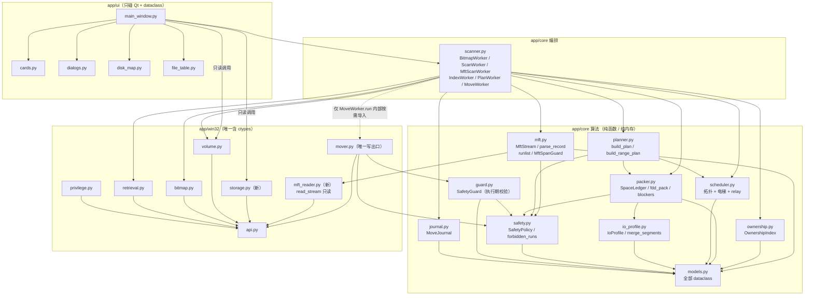
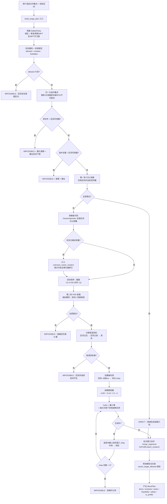
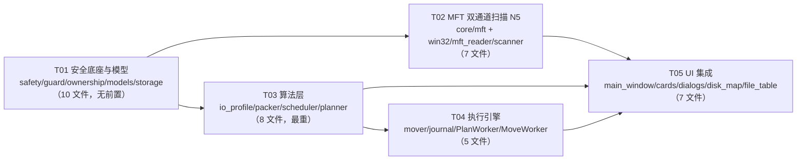

# LBA Mover v2 增量架构设计（ARCH-DELTA）

> 角色：架构师 高见远 · 输入：v1 已验收代码（23 py / ~7361 行）+ 5 项新需求（N1 安全保留区 / N2 LBA 万向移动 / N3 IO 调度 / N4 挡路碎片自动整理 / N5 MFT 直读扫描）
> 输出性质：**纯设计文档**，不修改任何代码文件
> 设计基线：Python 3.13 + PySide6 + ctypes(Win32)，严格类型注解 / dataclass / 纯函数算法 / UI 不碰 ctypes

---

## 0. 结论摘要（先看这一节）

| 项 | 结论 |
| --- | --- |
| 安全模型 | 引入 `SafetyPolicy` + `SafetyGuard` 双层不可变量：**几何禁区**（卷首/卷尾/MFT 区/MFT·MFTMirr 守卫窗）+ **对象禁区**（`$` 元数据 / 压缩 / EFS / 无分配一律不可作为搬运对象）。planner 规划时校验一次，mover **每次** `FSCTL_MOVE_FILE` 前再校验一次，并额外校验卷序列号与总簇数（防状态漂移） |
| 安全论证 | 写路径只有卷内 `FSCTL_MOVE_FILE`（参数是**卷内 LCN**），代码里不存在对 `\\.\PhysicalDriveN` 的写句柄；分区表/GPT 头尾在**卷外**，物理不可达。该论证可用 `IOCTL_VOLUME_GET_VOLUME_DISK_EXTENTS` 读出的 `StartingOffset` **实证**（偏移 > 0 即分区表在卷之前） |
| 核心算法 | 「**两轮装箱 + 驱逐 + 依赖排序 + 中转断环**」四段式：① 不驱逐先试 FDD 装箱 ② 标识挡路者、虚拟腾空后再试 ③ 挡路者按成本迁到区间外空闲区 ④ Kahn 拓扑（堆=电梯单向序）执行，剩余环用**中转（relay）**打断 |
| 为什么不用递归驱逐 | 驱逐目标一律取自「区间外的**当前空闲**区」，且预留所有 src/dst 区间 → **深度天然为 1，可证明不会撞占用**。仅当区间外空闲不足时，才允许深度 2（`ALLOW_REUSE_INSIDE`，默认关闭），并以 `max_relay_rounds=3` 硬上限兜底，超出即报不可行 |
| 内存加速的诚实定位 | **不是用户态缓冲拷贝**。`FSCTL_MOVE_FILE` 的数据链路在内核 NTFS 内部，用户态无法插入缓冲。真实有效的是四条 IO 调度策略：介质检测、段合并（针对我们裁切出来的小段）、预读预热（把 MOVE 的读方向变成缓存命中）、电梯单向排序。文档中逐条写明收益边界，不做线性提速承诺 |
| MFT 扫描通道（N5） | 直读 `$MFT`：先对 `$MFT` 自身取 runlist 拼出**逻辑字节流**（不假设 MFT 物理连续），再用卷原始句柄按 extents 读记录，**绕过逐文件 `CreateFile`**。三道防线：① 每次原始读都过 `MftSpanGuard`（卷内 + MFT 有效范围双重边界校验，越界**中止**而非截断）② 解析异常一律"计数 + 跳过"，绝不猜测 ③ 抽样复核（随机 N 条记录用 v1 的 `FSCTL_GET_RETRIEVAL_POINTERS` 复核 extents，不一致即降级回句柄通道）。MFT 通道**不 import `mover`**，仍是严格只读 |
| 任务数 | **5 个**（T01 安全底座与模型 / T02 MFT 双通道扫描 / T03 算法层 / T04 执行引擎 / T05 UI 集成），T02 与 T03 可并行 |
| 最高风险 | ① `MovePlan.total_move_clusters` 语义扩展（含驱逐）会改变进度分母与文案 ② `MoveWorker` 遍历对象从 `movable_items` 变为 `tasks`，漏改会导致驱逐任务不执行且**静默成功** ③ 挡路者归属依赖扫描索引，不建索引时小文件挡路者归属未知 → 只能报不可行 ④ **MFT 解析正确性**（USN 修复、runlist 有符号累加）一旦错就会产出"看起来合理但错误"的 extents，比崩溃更危险 → 靠抽样复核兜底 |

---

## 1. 增量架构总览

### 1.1 分层原则（延续 v1）

```
UI 层      app/ui/*          只碰 Qt + dataclass，绝不 import ctypes
─────────────────────────────────────────────────────────────
编排层    app/core/scanner.py   QThread Worker：只做"调用顺序 + 信号"，不含算法
算法层    app/core/{packer,planner,scheduler,io_profile,safety,ownership,guard,journal}.py
          纯函数 / 纯内存对象，零 IO、零 Qt、零 ctypes，可 100% 单测
─────────────────────────────────────────────────────────────
系统层    app/win32/*        唯一含 ctypes 的地方；只做"取数据 / 发一条 FSCTL"
```

新增模块全部落在**算法层**与**系统层**，UI 层只做数据绑定 —— 这是本次增量能"不破坏 v1 精致度"的前提。

### 1.2 新增 / 重构清单

| 模块 | 状态 | 职责 | 依赖 |
| --- | --- | --- | --- |
| `app/core/safety.py` | **新增** | 安全保留区模型（纯）：`SafetyPolicy`、禁区集合、下限夹紧、`assert_target_allowed`、安全论证文案生成 | models |
| `app/core/guard.py` | **新增** | 执行期守卫（纯）：`SafetyGuard` = policy + 位图快照 + 本次已占用目标区；`allow(lcn, clusters)` 是 mover 的第二道校验 | safety, models |
| `app/core/io_profile.py` | **新增** | IO 策略（纯）：`IoProfile`、介质→策略映射、`merge_segments`（批次窗口）、批次簇数换算、电梯排序键 | models |
| `app/core/ownership.py` | **新增** | `OwnershipIndex`：LCN 区间 → 文件 的 stabbing query，用于「挡路者归属反查」与「归属未知簇统计」；**同时是 N4 与 N5 的协同点**：MFT 通道一次扫描即产出全卷索引，N4 的挡路者反查从"要再扫一遍"变成"免费" | models |
| `app/core/mft.py` | **新增** | MFT 逻辑字节流 + 记录解析（纯）：`MftStream`、`FixupArray`、`AttrHeader`、`decode_runlist`、`MftRecord`、`parse_record`、`rebuild_path`、`MftSpanGuard`、`MftScanStats` | models, safety |
| `app/win32/mft_reader.py` | **新增** | MFT 原始读取（ctypes）：`read_stream(handle, extents, offset, length)` —— 严格边界校验后按 extent 分段 `ReadFile`，**只读、不 import mover** | api, volume |
| `app/core/packer.py` | **新增** | 区间装箱引擎（纯）：`TargetWindow`、`SpaceLedger`、`Feasibility`、`fdd_pack`、`find_blockers`、`build_evictions`、自重叠检测 | models, safety, io_profile |
| `app/core/scheduler.py` | **新增** | 依赖图 + Kahn 电梯序 + SCC 环检测 + relay 断环 | models, packer |
| `app/core/journal.py` | **新增** | 操作流水（append-only JSONL）+ 逆序回滚段构造 | models |
| `app/core/planner.py` | **重构** | 保留 `build_plan`（v1 末端模式，**输出逐字段不变**）；新增 `build_range_plan`（v2 主入口），内部 = `packer` + `scheduler` 编排 | packer, scheduler, safety |
| `app/core/models.py` | 扩展 | `VolumeInfo` +3 字段；`FileEntry` +3 字段；`Extent.overlaps()`；新增 `TargetWindow`/`Blocker`/`ExecutionTask`/`FeasibilityReport`；`MovePlan` 扩展；`BitmapSnapshot.range_is_free_fast` | — |
| `app/core/scanner.py` | 重构 | 扫描侧：`ScanWorker` 双通道化 + 新增 `MftScanWorker`（MFT 直读）/ `IndexWorker`（全卷归属索引，复用 MFT 通道）；规划侧：`PlanWorker` 新参数；执行侧：`MoveWorker` 改为按 `plan.tasks` 执行 + 预热 + 流水 + 卷身份校验 | 全部 core |
| `app/win32/storage.py` | **新增** | `IOCTL_STORAGE_QUERY_PROPERTY` 介质探测 + `IOCTL_VOLUME_GET_VOLUME_DISK_EXTENTS` 卷磁盘映射 | api |
| `app/win32/api.py` | 扩展 | `FILE_FLAG_SEQUENTIAL_SCAN`、`FILE_ATTRIBUTE_COMPRESSED/ENCRYPTED/SPARSE_FILE`、`GetFileAttributesW` 绑定 | — |
| `app/win32/mover.py` | 重构 | `execute_task` 新入口（带 guard/policy/journal）；`prewarm_file`；`rollback_segments`；旧 `execute_segments` 签名保留（关键字参数扩展） | guard, safety, io_profile |
| `app/win32/volume.py` | 扩展 | `NtfsVolumeData` 已解析 `mft2_start_lcn` / `bytes_per_file_record`，补写入 `VolumeInfo` | — |
| `app/win32/retrieval.py` | 扩展 | `get_basic_info(path) -> (extents, attributes, reason)`，前置识别压缩/EFS | — |
| `app/ui/main_window.py` | 重构 | 新增「目标区间」「安全保留区」「IO 加速」三张卡片与联动；状态机扩展 | core |
| `app/ui/cards.py` | 扩展 | 新增 `RangeField`（双数值框 + 换算说明，复用现有 QSS） | — |
| `app/ui/dialogs.py` | 扩展 | 新增 `BlockersDialog`（挡路清单预览/排除）；`DangerConfirmDialog` 增加「目标区间 / 驱逐文件数 / 中转次数」三行 | — |
| `app/ui/disk_map.py` | 扩展 | `set_target_window` / `set_blockers` / `set_evict_targets`（复用 accent / warning / mft 三色，不新增调色板键） | — |
| `app/ui/file_table.py` | 扩展 | `status_kind()` 增补「挡路·待迁出」「已迁出」「中转中」语义色 | — |

### 1.3 模块依赖图



> 关键约束保持：`app.win32.mover` 仍只在 `MoveWorker.run()` 内部按需导入，预览模式路径上不存在写操作调用点（`import app.ui.main_window` 后 `'app.win32.mover' not in sys.modules` 仍成立）。
> `storage.py`（介质探测）与 `mft_reader.py`（MFT 原始读取）都是**严格只读**模块（不含任何 FSCTL 写码、不含 `FSCTL_MOVE_FILE`、不 import `mover`），允许 UI / 预览模式直接调用。
> N5 的 `mft.py` / `mft_reader.py` 在依赖图上**没有任何路径指向 `MOV`** —— 这是"只读不可越界"的结构性保证，可用 import 隔离验证。

---

## 2. 安全保留区模型（N1）

### 2.1 威胁模型与结论

用户担心的真实威胁是「LBA 移动破坏分区表」。把它拆成三条物理路径逐条封堵：

| 路径 | 是否可能 | 封堵手段 |
| --- | --- | --- |
| ① 程序直接写卷外扇区（磁盘 LBA 0 的 MBR/GPT、磁盘末尾的 GPT 备份） | **不可能**。全代码库只有一条写路径 `FSCTL_MOVE_FILE`，其 `StartingLcn` 是**卷内簇号**，由 NTFS 驱动校验 `LCN + ClusterCount <= TotalClusters`，越界返回 `ERROR_INVALID_PARAMETER`。程序从不以写权限打开 `\\.\PhysicalDriveN` | 架构约束 + 代码审查（可 `grep PhysicalDrive` 证明无写句柄） |
| ② 把文件数据搬进 `$Boot` 所在簇，覆写 VBR / 引导代码，导致"看起来像分区表被破坏" | **可能**，这是唯一真实风险 | **卷首保留区**（默认 ≥1 MiB，硬下限不可为 0）+ `$` 元数据对象禁区 + 目标必须是位图空闲簇（`$Boot` 的簇恒为已占用）三重保护 |
| ③ 覆写卷尾的**备份引导扇区**（NTFS 在卷最后一个扇区存 VBR 副本） | 可能 | **卷尾保留区**（默认 ≥1 MiB，硬下限不可为 0） |
| ④ 触发 MFT 扩张，把新 MFT 记录写进我们正在搬的数据区 | 可能 | **MFT 区禁区** `[MftZoneStart, MftZoneEnd)` 全段禁用（v1 已有，v2 保留为硬不变量） |
| ⑤ `$MFT` / `$MFTMirr` 本身落在 MFT 区之外 | 可能（MftZoneStart 只是"建议保留区"） | **守卫窗**：`[MftStartLcn, MftStartLcn+8)` 与 `[Mft2StartLcn, Mft2StartLcn+8)` 额外禁用 |

**给用户看的安全论证（可直接进 UI 说明文案）**

> 本工具**只通过 `FSCTL_MOVE_FILE` 在卷内部搬动文件的数据簇**，它的寻址单位是该卷的**逻辑簇号（LCN）**，而不是物理磁盘的 LBA。
> 分区表（MBR 分区表 / GPT 主头与备份头）位于**分区的第一个扇区之前**与**磁盘的最末尾**，属于卷之外；本程序从不打开物理磁盘的写句柄，也不接受任何物理 LBA 参数，因此**在物理上无法触及分区表**。
> 在卷的内部，唯一可能"看起来像破坏引导区"的风险是把数据写进 `$Boot`（VBR 就存在这个文件里）。为此我们固定保留卷首与卷尾各一段安全区（默认各 1 MiB 起，且**不允许设为 0**），并把 `$Boot`/`$MFT` 等 `$` 开头的系统文件列为不可搬动对象。

**可实证的补充证据**：`IOCTL_VOLUME_GET_VOLUME_DISK_EXTENTS` 能读出该卷在物理磁盘上的 `StartingOffset`。若 `StartingOffset > 0`（绝大多数情况），UI 可直接显示「本卷起始于磁盘偏移 X，分区表位于卷之前，不在可写范围内」。这比口头保证更有说服力。

### 2.2 数据结构

```python
# app/core/safety.py —— 纯，无 Qt / 无 ctypes
HEAD_RESERVE_MIN_BYTES: int = 1 * MB          # 卷首保留硬下限
TAIL_RESERVE_MIN_BYTES: int = 1 * MB          # 卷尾保留硬下限
HEAD_RESERVE_MIN_CLUSTERS: int = 16           # 与字节下限取大
TAIL_RESERVE_MIN_CLUSTERS: int = 16
HEAD_RESERVE_DEFAULT_MB: int = 16             # 默认给足，用户可调大不可调小到下限以下
TAIL_RESERVE_DEFAULT_MB: int = 16
MFT_GUARD_CLUSTERS: int = 8                   # MftStartLcn / Mft2StartLcn 周边守卫宽度

@dataclass(slots=True, frozen=True)
class SafetyPolicy:
    """一个卷的安全保留区快照。纯数据，可序列化进计划、可单测。"""
    total_clusters: int = 0
    bytes_per_cluster: int = 0
    head_reserve_clusters: int = 0        # 卷首禁区 [0, head)
    tail_reserve_clusters: int = 0        # 卷尾禁区 [total-tail, total)
    mft_zone_start: int = 0
    mft_zone_end: int = 0
    mft_start_lcn: int = 0
    mft2_start_lcn: int = 0
    mft_guard_clusters: int = MFT_GUARD_CLUSTERS
    protect_mft_zone: bool = True         # UI 可显示但不可关闭（关闭仅用于单测注入）
    guard_metadata: bool = True           # 恒 True：$ 前缀对象不可搬运

    @property
    def allowed_clusters(self) -> int: ...
    def forbidden_runs(self) -> List[Tuple[int, int]]: ...      # 已合并、升序、open-ended
    def is_cluster_allowed(self, lcn: int) -> bool: ...
    def is_range_allowed(self, lcn: int, clusters: int) -> bool: ...
    def describe(self) -> str: ...                              # 一行中文摘要（日志/UI）


class SafetyViolation(RuntimeError):
    """目标簇越过安全保留区 / 卷边界。planner 与 mover 都抛这个。"""
    lcn: int; clusters: int; reason: str
```

### 2.3 参数与安全下限（可配置 + 硬下限）

| 参数 | UI 控件 | 可调范围 | 硬下限（不可突破） |
| --- | --- | --- | --- |
| 卷首保留 | `SliderField(MB)` | `[HEAD_MIN, total/2]` | `max(16 簇, 1 MiB)`；控件 `set_range` 的 minimum 就是该值 → **用户无法输入 0** |
| 卷尾保留 | `SliderField(MB)` | `[TAIL_MIN, total/2]` | 同上 |
| MFT 区保护 | 只读徽章「已强制保护」+ 范围文案 | — | 不可关闭 |
| 元数据对象保护 | 只读徽章「$ 系统文件一律不可搬运」 | — | 不可关闭 |

`build_policy()` 是唯一的构造入口，内部**强制夹紧**：

```python
def clamp_reserve_mb(requested_mb: int, bytes_per_cluster: int, total_clusters: int) -> int:
    """把用户请求的 MB 夹到安全区间内。任何调用方（含未来的 CLI/配置文件）都无法绕过。"""
    floor_clusters = max(HEAD_RESERVE_MIN_CLUSTERS,
                         ceil_div(HEAD_RESERVE_MIN_BYTES, bytes_per_cluster))
    ceil_clusters = total_clusters // 2
    requested = requested_mb * MB // bytes_per_cluster
    return clamp(requested, floor_clusters, ceil_clusters) * bytes_per_cluster // MB + 1
```

> 设计要点：下限校验放在 **core 纯函数**而不是 UI 校验里，这样即便未来加 CLI / 配置文件 / 脚本调用，也不可能出现"保留区 = 0"的计划。

### 2.4 双校验落点

```
规划期（第一道）                               执行期（第二道）
─────────────────────────────────────       ─────────────────────────────────────
packer.assess()        → 禁区参与"可用量"计算   MoveWorker.run() 启动前：
packer.fdd_pack()      → 只在 allowed 子区间放置   1) 重新 open 卷 + FSCTL_GET_NTFS_VOLUME_DATA
planner.build_range_plan() 收尾：                  2) 比对 volume_serial 与 total_clusters
   for task in tasks:                              → 不一致即拒绝执行（状态漂移）
       for seg in task.segments:               3) 重新读取位图快照（可选，"严格模式"）
           safety.assert_target_allowed(policy,    每次 FSCTL_MOVE_FILE 之前：
               seg.dst_lcn, seg.clusters, "规划")   guard.allow(dst_lcn, clusters) → (ok, reason)
                                                    ok=False ⇒ 记 MoveFailure，**不调用 FSCTL**
```

`SafetyGuard` 的校验条件（全部满足才允许写）：

```python
@dataclass(slots=True)
class SafetyGuard:
    policy: SafetyPolicy
    snapshot: BitmapSnapshot                 # 计划生成时的位图（用于"目标仍空闲"判断）
    reserved: List[Tuple[int, int]]  = ()    # 本次已成功写入的目标区（防重复占用）

    def allow(self, lcn: int, clusters: int) -> Tuple[bool, str]:
        # 1) clusters > 0
        # 2) 卷内：0 <= lcn 且 lcn + clusters <= policy.total_clusters
        # 3) 不越禁区：policy.is_range_allowed(lcn, clusters)
        # 4) 不与本次已占用目标区重叠
        # 5) 位图显示空闲（range_is_free_fast）
    def reserve(self, lcn: int, clusters: int) -> None: ...
    def release(self, lcn: int, clusters: int) -> None:
        """回滚时把目标区还回可用池。"""
```

> 与 v1 的差异：v1 的 `MoveWorker._target_is_safe` 只查 MFT 区 + 已占用 + 位图；v2 把这段逻辑**上移**为可单测的 `SafetyGuard`，并补上卷首/卷尾/MFT 守卫窗，同时把"校验通过后登记占用"变成显式 `reserve()`（v1 是在文件成功后批量登记，v2 改为**逐段成功后立即登记**，防止同文件后续段重复落到同一处）。

### 2.5 禁区集合的计算（纯函数，O(k log k)）

```python
def forbidden_runs(self) -> List[Tuple[int, int]]:
    total = self.total_clusters
    runs: List[Tuple[int, int]] = []
    if self.head_reserve_clusters > 0:
        runs.append((0, min(total, self.head_reserve_clusters)))
    if self.tail_reserve_clusters > 0:
        runs.append((max(0, total - self.tail_reserve_clusters), total))
    if self.protect_mft_zone and self.mft_zone_end > self.mft_zone_start:
        runs.append((self.mft_zone_start, min(total, self.mft_zone_end)))
    if self.guard_metadata:
        if self.mft_start_lcn > 0:
            runs.append((self.mft_start_lcn,
                         min(total, self.mft_start_lcn + self.mft_guard_clusters)))
        if self.mft2_start_lcn > 0:
            runs.append((self.mft2_start_lcn,
                         min(total, self.mft2_start_lcn + self.mft_guard_clusters)))
    return merge_runs([r for r in runs if r[1] > r[0]])
```

复用 `bitmap.merge_runs` 与 `bitmap.subtract_runs`（v1 已有，纯函数，无需重写）。

---

## 3. 区间装箱引擎（N2 + N4）

### 3.1 目标区间的表达与输入方式

```python
# app/core/packer.py
@dataclass(slots=True, frozen=True)
class TargetWindow:
    start_lcn: int = 0
    end_lcn: int = 0                    # 开区间

    @property
    def clusters(self) -> int: return max(0, self.end_lcn - self.start_lcn)
    def contains(self, lcn: int, clusters: int) -> bool
    def clipped(self, total_clusters: int) -> "TargetWindow"
    def intersect(self, runs) -> List[Tuple[int, int]]

def window_from_tail(total_clusters: int, tail_clusters: int, tail_guard: int) -> TargetWindow:
    """「从末端倒数 N GB」快捷：终点停在卷尾保留区之前。"""
    end = max(0, total_clusters - tail_guard)
    return TargetWindow(max(0, end - tail_clusters), end)

def window_from_length(start_lcn: int, clusters: int, total: int) -> TargetWindow:
    """「从某 LCN 起连续 N GB」快捷。"""
    return TargetWindow(start_lcn, min(total, start_lcn + clusters))

def window_text(window: TargetWindow, bytes_per_cluster: int) -> str:
    """UI 展示：LCN 1,048,576 – 3,145,728（偏移 4.0 GB – 12.0 GB，共 8.0 GB / 2,097,152 簇）"""
```

三种输入方式（UI 全部映射到 `TargetWindow`，**只有一个真源**）：

| 模式 | 控件 | 映射 |
| --- | --- | --- |
| 末端区间（v1 语义的推广） | `SliderField(GB)` + 快捷预设 10/50/100 GB | `window_from_tail(total, n, tail_guard)` |
| 绝对 LCN 区间 | `RangeField` 两个 `QSpinBox`（`start_lcn` / `end_lcn`）+ 下方实时换算 caption | 直接构造 |
| 起点 + 长度 | `RangeField`（`start_lcn` / `length_gb`） | `window_from_length(...)` |

> **v1 迁移路径**：v1 的"末端预留区"滑块保留原位置与手感，语义改为「末端区间 = 卷尾倒数 N MB，且自动避开卷尾保留区」，见 §8 兼容性说明。

### 3.2 可行性预判（三档，量化）

```python
VERDICT_DIRECT = "direct"              # 直接可行（不驱逐）
VERDICT_EVICT  = "needs_eviction"      # 可行，需驱逐 N 个挡路文件
VERDICT_IMPOSSIBLE = "impossible"      # 不可行 + 量化原因 + 建议

@dataclass(slots=True)
class FeasibilityReport:
    verdict: str = VERDICT_IMPOSSIBLE
    window_clusters: int = 0
    usable_clusters: int = 0           # 区间扣除禁区后的可用簇数
    selected_clusters: int = 0         # 选中文件总簇数
    free_in_window: int = 0            # 区间内当前空闲簇
    blocked_clusters: int = 0          # 区间内被其他文件占用簇
    evictable_clusters: int = 0        # 可迁出的挡路簇
    unknown_owner_clusters: int = 0    # 位图占用但归属未知（无法驱逐）
    largest_file_clusters: int = 0
    shortfall_clusters: int = 0        # 不可行时差多少簇
    blockers: List["Blocker"] = field(default_factory=list)
    reasons: List[str] = field(default_factory=list)       # 不可行的量化原因（多条）
    suggestions: List[str] = field(default_factory=list)   # 建议（区间放大到 X、先迁走 Y…）
    @property
    def headline(self) -> str: ...                         # 一行徽章文案
```

判定顺序（**先做算术剪枝，再做装箱验证**，保证 O(n log n) 而不是盲目搜索）：

```
1) usable = |区间 ∩ 非禁区|
2) if largest_file > usable                    → IMPOSSIBLE
      原因："文件 F 需 X 簇，大于区间可用 Y 簇（差 Z 簇）"
      建议："把区间放大到至少 Z 簇（≈ N GB）"
3) if selected_sum > usable                    → IMPOSSIBLE
      原因："选中文件共需 X 簇，区间可用仅 Y 簇（差 Z 簇，≈ N GB）"
4) 第一轮 FDD 装箱（只用区间内**当前空闲**簇）
   if 全部落位                                 → DIRECT
5) 标识挡路者（§3.4），算出可驱逐簇集合 + 归属未知簇
6) 第二轮 FDD 装箱（虚拟腾空：区间内"空闲簇 ∪ 将被驱逐的簇"）
   if 全部落位：
       if 驱逐目标分配成功                      → NEEDS_EVICTION
       else → IMPOSSIBLE（原因："区间外连续空闲不足，还需 N 簇"}
   else:
       IMPOSSIBLE（原因："即使腾走全部可驱逐簇，仍差 N 簇；
                          其中 M 簇归属未知（可能是未扫描的小文件/目录），
                          请开启「全卷归属索引」后重新评估"）
```

三档在 UI 上的表现：`Badge` 文案 + 语义色 —— `直接可行`(success) / `需驱逐 37 个文件`(warning) / `不可行`(danger)；hover 或点击展开 `reasons` + `suggestions`。

### 3.3 FDD 装箱（First-Fit-Decreasing，确定性）

```python
class SpaceLedger:
    """可分配空间账本：纯内存、确定性、可 release（供自重叠/relay 场景回滚）。"""
    def __init__(self, runs: Sequence[Tuple[int, int]]) -> None
    def allocate(self, clusters: int, near: Optional[int] = None) -> Optional[int]:
        """first-fit 分配连续 clusters 簇，返回起始 LCN。
        near 不为 None 时按「优先 ≥ near 的最低段 → 次选 < near 的最高段」挑选，
        用于把驱逐目标优先放到区间之后，其次区间之前。"""
    def release(self, start: int, clusters: int) -> None
    def free_clusters(self) -> int
    def runs(self) -> List[Tuple[int, int]]

def fdd_pack(
    entries: Sequence[FileEntry],
    ledger: SpaceLedger,
    allowed: Sequence[Tuple[int, int]],
    *,
    avoid_self_overlap: bool = True,
) -> Tuple[Dict[str, int], List[Tuple[FileEntry, str]]]:
    """按「簇数降序、路径升序」依次为每个文件寻找**连续**目标块。

    Returns: (path -> target_lcn, [(未能放置的文件, 中文原因)])
    """
    order = sorted(entries, key=lambda e: (-e.allocated_clusters, e.path.lower()))
    placed: Dict[str, int] = {}
    unplaced: List[Tuple[FileEntry, str]] = []
    for entry in order:
        need = entry.allocated_clusters
        if need <= 0: unplaced.append((entry, "无物理分配")); continue
        target = _place_one(entry, need, ledger, allowed, avoid_self_overlap)
        if target is None: unplaced.append((entry, f"剩余连续空间不足（需 {need:,} 簇）")); continue
        placed[entry.path] = target
    return placed, unplaced

def _place_one(entry, need, ledger, allowed, avoid_self_overlap) -> Optional[int]:
    """候选起点按升序尝试；对每个可用段尝试三种落点：
       a) 段首（最紧凑，优先）
       b) 紧贴该文件自身最大 extent 末尾之后（避免自重叠，代价是留小空洞）
       c) 段尾对齐（target = run.end - need）
       任一起点满足"目标块与自身 src 不相交"（avoid_self_overlap）即接受；
       若无满足者但存在可用段 → 返回段首落点，由上层标记 role="relay"。"""
```

**正确性不变量（必须由单测逐条覆盖）**

| 编号 | 不变量 |
| --- | --- |
| INV-1 | 任意两个文件的目标块**不相交** |
| INV-2 | 每个目标块 ⊆ `allowed`（区间 ∩ 非禁区） |
| INV-3 | 每个目标块是**连续**区间，长度恰为 `entry.allocated_clusters` |
| INV-4 | 每个目标块与 `policy.forbidden_runs()` 交集为空 |
| INV-5 | 目标块在**执行时刻**位图空闲（由 phase 顺序 + `SafetyGuard` 保证，非打包期保证） |
| INV-6 | 每个文件的目标块与其**当前** src 不相交；否则该文件必须带 `role="relay"` |
| INV-7 | 执行序列中任一任务的 dst 不与其后任何任务的 src 重叠（拓扑序保证） |
| INV-8 | 驱逐目标不在区间内、不在禁区、不与任何 src/dst 相交 |

### 3.4 挡路者识别（N4）

```python
# app/core/models.py
@dataclass(slots=True)
class Blocker:
    path: str = ""
    name: str = ""
    size: int = 0
    total_clusters: int = 0
    clusters_in_window: int = 0                 # 落在区间内的簇数（= 需搬簇数）
    extents_in_window: List[Extent] = ...       # 需要迁出的具体切片
    fragments_in_window: int = 0                # 切片数（碎片惩罚依据）
    cost: float = 0.0                           # 成本分，越小越先搬
    excluded: bool = False                      # 用户勾选"排除"
    reason: str = ""                            # 非空 = 不可驱逐（归属未知/元数据/不可移动）

EVICT_FRAGMENT_PENALTY: float = 0.35
def blocker_cost(clusters_in_window: int, fragments_in_window: int) -> float:
    """成本 = 需搬簇数 × (1 + 0.35 × (切片数 - 1))。优先搬「小且连续」。"""
    return clusters_in_window * (1.0 + EVICT_FRAGMENT_PENALTY * max(0, fragments_in_window - 1))
```

归属反查由 `OwnershipIndex` 完成（区间 stabbing query）：

```python
# app/core/ownership.py
@dataclass(slots=True)
class OwnershipIndex:
    """LCN 区间 → 文件 的查询索引（纯内存，O(log n + k)）。"""
    _starts: List[int] = ...        # 按 extent.lcn 升序
    _max_end_prefix: List[int] = ...# 前缀最大 lcn_end，用于反向剪枝
    _records: List[Tuple[int, int, int, int, str]] = ...  # (lcn, lcn_end, vcn, path_idx)

    @classmethod
    def build(cls, entries: Sequence[FileEntry]) -> "OwnershipIndex": ...
    def query(self, start: int, end: int) -> List[Tuple[str, Extent]]:
        """返回与 [start, end) 相交的所有 (path, extent 的相交切片)。"""
    def covered(self, start: int, end: int) -> int:
        """已被索引覆盖的簇数；与位图占用簇数相减即得"归属未知簇数"。"""
```

**归属未知（诚实边界，必须写进 UI）**

> 位图告诉我们"某个簇被占用"，但 Win32 没有 API 能"由 LCN 反查文件路径"。
> 因此本工具只能识别**扫描过**的文件。默认只扫描大于阈值的文件（v1 行为），
> 落在区间内的小文件 / 目录 / 元数据都属于**归属未知**，无法自动驱逐。

因此提供两种模式：

| 模式 | 行为 | 代价 | 何时用 |
| --- | --- | --- | --- |
| **快速模式**（默认） | 只用已扫描文件建索引；未知簇 → 计入 `unknown_owner_clusters`，使可行性降级为 IMPOSSIBLE 并给出"请开启全卷索引"的建议 | 0 额外耗时 | 区间内主要是大文件时 |
| **全卷归属索引** | `IndexWorker` 遍历全卷**所有**文件（`min_size=1`）解析 extents 建索引；可取消、带进度 | 10 万~50 万文件 ≈ 20 s~2 min（一次 IOCTL/文件） | 需要精确定位挡路者时，UI 用显式按钮触发 + 说明耗时 |

`IndexWorker` 复用 `ScanWorker` 的遍历骨架，但：
* 跳过 `$` 前缀文件与系统目录（同 v1 `SKIP_DIR_NAMES`）；
* **不构建 extents 列表给 UI**，只增量灌进 `OwnershipIndex` 的构建缓冲（省内存：用 `array('q')` 或紧凑 tuple 列表）；
* 内存上界：50 万文件 × 平均 3 个 extent × 40 B ≈ 60 MB，可接受；超过 400 万 extent 时拒绝并提示。

### 3.5 驱逐子计划生成

```python
def build_evictions(
    blockers: Sequence[Blocker],
    ledger_out: SpaceLedger,          # 区间外、非禁区、已扣除所有 src/dst 预留
    window: TargetWindow,
) -> Tuple[List[PlanItem], List[str]]:
    """按成本升序为每个挡路切片分配区间外的连续目标，生成 "evict" 计划项。

    目标优先顺序：区间之后（>= window.end，升序）→ 区间之前（< window.start，降序）→ 其余。
    与 v1 的"末端迁移"哲学一致：把杂物尽量推向卷尾。
    """
    failures: List[str] = []
    items: List[PlanItem] = []
    for blocker in sorted(blockers, key=lambda b: (b.cost, b.path.lower())):
        if blocker.excluded: continue
        if blocker.reason:
            failures.append(f"{blocker.name}：{blocker.reason}")
            continue
        for extent in blocker.extents_in_window:          # 只搬真正挡路的那一段
            target = ledger_out.allocate(extent.clusters, near=window.end)
            if target is None:
                failures.append(
                    f"{blocker.name}：区间外无 {extent.clusters:,} 簇连续空闲，无法迁出")
                break
            items.append(PlanItem(
                entry=_blocker_entry(blocker),
                role="evict",
                target_lcn=target,
                clusters=extent.clusters,
                segments=[MoveSegment(vcn=extent.vcn, src_lcn=extent.lcn,
                                      dst_lcn=target, clusters=extent.clusters)],
            ))
    return items, failures
```

**驱逐目标的安全约束**：候选空间 = `位图空闲 − 禁区 − 目标区间 − 所有选中文件的 src extents − 所有已分配的驱逐/中转目标`。最后两项由 `SpaceLedger` 初始 `runs` 预先扣除，此后每次 `allocate` 自动扣减。

### 3.6 顺序性：依赖图 + 电梯序 + 环断裂

```python
# app/core/scheduler.py
def build_dependencies(tasks: Sequence[ExecutionTask]) -> Dict[int, Set[int]]:
    """边 B → A 表示「A 的目标覆盖了 B 的源」，故 B 必须先执行。"""
    edges = {t.order: set() for t in tasks}
    for a in tasks:
        for b in tasks:
            if a is b: continue
            if ranges_overlap(a.dst_range, b.src_range):
                edges[a.order].add(b.order)      # b 先于 a
    return edges

def order_elevator(
    tasks: Sequence[ExecutionTask],
    edges: Dict[int, Set[int]],
    sweep: str = "ascending",
) -> Tuple[List[ExecutionTask], List[int]]:
    """Kahn 拓扑排序，就绪集合用**最小堆按 dst_lcn 排序**（电梯单向）。
    返回 (执行序, 未能排序的剩余节点 = 环成员)。"""
```

**为什么用「Kahn + 堆」而不是"先拓扑再排序"**：电梯序与依赖序会冲突（拓扑要求 B 先，而 A 的目标 LCN 更小），二者不能串行拼接。用最小堆替换 Kahn 的就绪队列，可在**每个拓扑层内自由选择**时贪心地走同方向，同时**永不违反依赖**。这是本设计的核心技巧，也是唯一能同时满足两条约束的多项式解法。

**环断裂（relay 中转）**

```
while 存在未排序节点:
    scc = tarjan_scc(剩余子图)                # 缩点找环
    if 所有 scc 都是单点（自环）或不存在环: break
    cycle = 选 scc 大小 > 1 的环中「中转成本最小」的文件
            成本 = 该文件需搬簇数（relay 会搬两遍）
    relay_slot = ledger_relay.allocate(该文件总簇数, near=window.end)
    if relay_slot is None:
        → IMPOSSIBLE("缺少 N 簇中转空间；建议扩大空闲区或减少选中文件")
    # 插入两条任务：src → relay（phase="relay_out"），relay → dst（phase="relay_in"）
    #   relay_out 无依赖（relay 在区间外空闲处，与任何 src/dst 不相交）
    #   relay_in  依赖 relay_out + 原环上所有前驱
    relay_rounds += 1
    if relay_rounds > MAX_RELAY_ROUNDS(3):
        → IMPOSSIBLE("依赖环过多（>3 层中转），建议改小目标区间或分批执行")
    recompute_edges(); retry
```

**自重叠（同一文件的目标压到自己身上）** 单独处理，不进依赖图：

```
for item in placement_items:
    if self_overlap(item):          # 目标块 ∩ 该文件当前 src ≠ ∅
        item.role = "relay"
        relay_slot = ledger_relay.allocate(item.clusters, near=window.end)
        if relay_slot is None → IMPOSSIBLE("缺少 N 簇中转空间")
        item.segments = [src → relay] + [relay → dst]   # 两阶段
```

> 选择 relay 而非"挪走目标块"的理由：推迟到中转再回来，**能保证目标布局仍然完全紧凑**（这是本工具的目的）；若改挪目标块，会在区间内留下无法利用的空洞，且可能连锁触发新的不可行。代价是这些文件被搬两遍，成本必须如实计入计划统计与提示。

### 3.7 中止与回滚策略（选定的主方案）

**主方案：如实报告部分完成 + 可选"尽力回滚"（不做自动回滚）**

| 决策 | 取值 | 理由 |
| --- | --- | --- |
| 单段失败后 | **默认继续**同文件其余段（保持 v1 行为），可通过 `on_error="halt"` 切换为整轮停止 | 兼容 v1 已文档化的行为（README §九-6）；同时给用户"立刻止损"的开关 |
| 致命错误定义 | 连续 8 段失败 / 卷序列号或总簇数变化 / `SafetyGuard` 拒绝 / 全局取消 | 这类错误意味着"世界已经不是我们规划的那个世界"，继续搬运只会扩大损害 |
| 流水记录 | `MoveJournal` append-only **JSONL**，每条成功/失败的段各一行，`flush()` 每行 → 断电最多丢一行 | 崩溃后仍能重建"哪些段真的搬了" |
| 回滚 | UI 在失败/取消后显示「尝试回滚已完成的 N 段」按钮（仅当 journal 非空）；回滚 = 按**逆序**把 `src↔dst` 互换重新执行，执行前重新读取该文件当前 extents 校验 dst 段仍属于该文件、原 src 仍空闲 | `FSCTL_MOVE_FILE` 没有内核级事务，只能"反向再搬一次"。**不自动执行**，因为反向搬运同样可能失败、耗时且需要用户确认 |
| 回滚失败 | 记日志 + 报"回滚 N 段成功 / M 段失败，请勿再对卷写入" | 诚实 |

**为什么不做"事务式回滚"**：`FSCTL_MOVE_FILE` 逐段提交，内核不提供批量原子性；且在已失败的状态下自动反向搬运会放大"程序正在写盘"的时间窗口，风险高于收益。选"报告 + 手动触发"，把最终决定权交回用户。

### 3.8 完整流程图



---

## 4. MFT 直读扫描通道（N5）

> 本节是全文档**风险最高**的一节：它直接解析原始卷上的二进制结构。因此本节按「能拿到什么 → 怎么解析 → 三道防线」的顺序写，其中 **§4.6 安全控制** 与 **§4.8 抽样复核** 是必读部分。

### 4.1 为什么值得做（v1 句柄通道的三个硬伤）

| 硬伤 | 根因 | MFT 通道的改善 | 量级 |
| --- | --- | --- | --- |
| 慢 | 每个文件一次 `CreateFile` + 一次 `FSCTL_GET_RETRIEVAL_POINTERS`，两次内核往返（≈0.1–0.3 ms/文件） | 一次**顺序**读 `$MFT`（≈200 MB 连续数据）+ 纯 Python 解析 | 20 万文件：句柄 ≈ 40–60 s → MFT ≈ 6–12 s（**3–8×**，须实测确认） |
| 看不全 | 被独占打开的文件（`pagefile.sys`/`hiberfil.sys`/注册表 hive）`CreateFile` 直接失败 → extents 拿不到 | 不再 `CreateFile`，直接从 MFT 记录里读 `$DATA` runlist → **看得到** | 从"完全看不到"到"能看到布局" |
| 可能漏 | 目录遍历受 ACL / 隐藏属性 / reparse point 影响 | MFT 是卷上**所有**文件的权威清单，不经过目录树 | 从"可能漏"到"全量" |

**但要立刻说清楚两条边界（写进 UI，不许含糊）**：

1. **"看得到"≠"搬得动"**：被独占的文件 `FSCTL_MOVE_FILE` 仍会因 `CreateFile` 失败而不可能移动。MFT 通道只是让它在列表里**可见并可规划绕过**（例如把它当成不可驱逐的挡路者，从而在可行性预判阶段就告诉用户"这块区间动不了"）。这比 v1 的"执行到一半才发现"好得多。
2. **N4 的协同收益**：`IndexWorker` 需要的「全卷 LCN→文件 归属索引」，在 MFT 通道下**与主扫描是同一次工作**（解析时就顺带产出 `OwnershipIndex`）。v1/句柄通道下这要额外再扫一遍（20 s–2 min）。因此 **MFT 通道让 N4 从"可选的重操作"变成"免费"** —— 这是 N5 与 N4 最重要的协同点，也是本次增量的最大整体收益。

### 4.2 第一步：定位 `$MFT` 自身（不能假设物理连续）

`$MFT` 自己就是一个可能碎片化的文件，它的数据分散在卷的各处。所以：

```
1) 用现有能力打开卷句柄（只读，GENERIC_READ）
2) 对 $MFT 取 runlist：
   首选：CreateFile("C:\\$MFT", FILE_READ_ATTRIBUTES) + FSCTL_GET_RETRIEVAL_POINTERS
         （Windows 允许打开 $MFT 这个特定元数据文件；若失败见下）
   回退：从 NTFS_VOLUME_DATA_BUFFER 只能拿到 MftStartLcn（首段起点），
         拿不到完整 runlist → 无法继续 → 整体降级到句柄通道（明确告知原因）
3) 用 MftValidDataLength 界定逻辑流有效长度
4) 组装 MftStream：
       segments = [(logical_offset, lcn, clusters_bytes), ...]   # 按 vcn 升序
       逻辑字节流长度 = MftValidDataLength（不是数据大小，避免读到未初始化区）
5) 记录号 n → 逻辑偏移 = n × BytesPerFileRecordSegment
```

`MftStream` 提供"逻辑偏移 → 物理位置"的映射，**任何一次原始读都必须先过它**：

```python
@dataclass(slots=True)
class MftStream:
    """$MFT 的逻辑字节流（runlist 拼装结果）。"""
    extents: List[Extent] = ...          # 复用 v1 Extent（lcn=-1 不会出现在这里）
    valid_length: int = 0                # = MftValidDataLength
    record_size: int = 1024              # = BytesPerFileRecordSegment（禁止硬编码）
    bytes_per_cluster: int = 0
    bytes_per_sector: int = 512          # 用于扇区对齐读取

    def locate(self, offset: int, length: int) -> List[Tuple[int, int, int]]:
        """把逻辑区间 [offset, offset+length) 拆成 [(物理字节偏移, 逻辑偏移, 长度)]。
           越界由 MftSpanGuard 负责，本方法只做映射。"""
    def record_offset(self, record_no: int) -> int:
        return record_no * self.record_size
```

### 4.3 第二步：记录解析（`$FILE` 结构）

**记录长度必须取 `NTFS_VOLUME_DATA_BUFFER.BytesPerFileRecordSegment`**（偏移 48）。绝大多数是 1024，但**不允许硬编码** —— 大簇卷/特殊格式化下可能是 4096。

```
FILE 记录头（record_size 字节内，偏移为字节）：
  0x00  magic        char[4]  必须是 "FILE"（否则跳过并计数 bad_magic）
  0x04  usa_offset   u16      Update Sequence Array 偏移
  0x06  usa_count    u16      = record_size / 512 + 1
  0x08  lsn          u64
  0x10  sequence     u16
  0x12  hardlink_cnt u16
  0x14  first_attr   u16      第一个属性的偏移
  0x16  flags        u16      0x0001 = in use, 0x0002 = directory
  0x18  used_size    u32
  0x1C  alloc_size   u32
  0x20  base_ref     u64      低 48 位 = base 记录号（≠0 表示这是 extension record）
  0x28  next_attr_id u16
  0x2C  record_no    u32      （NTFS 3.1+ 才有）
```

#### ⚠ 4.3.1 Update Sequence Array（修复数组）—— 必须最先处理

**原理**：NTFS 把每条记录按 512 字节扇区写入。为保证"多扇区写入被中断"能被检测，写入时会把**每个扇区最后 2 字节**替换成一个序号 `USN`（Update Sequence Number），并把被替换掉的原始 2 字节保存在记录头部的 USA 数组里。因此：

> **任何属性解析之前，必须先用 USA 把每个扇区尾部的 2 字节还原成原值。** 否则任何跨越扇区边界的属性（尤其是 `$FILE_NAME`、长 runlist）都会解析出垃圾 —— 这是手写实现最常翻车的地方。

**还原算法（含完整性校验）**

```python
def apply_fixup(record: bytearray, record_size: int) -> bool:
    """就地还原 USA。返回 False 表示记录损坏（多扇区写被撕裂），调用方必须跳过该记录。"""
    if len(record) < record_size:                       return False
    if record[0:4] != b"FILE":                          return False
    usa_offset = u16(record, 0x04)
    usa_count  = u16(record, 0x06)
    expected   = record_size // 512 + 1
    if usa_count != expected:                           return False     # 结构不符 → 不猜
    if usa_offset + usa_count * 2 > record_size:        return False     # 越出记录 → 不猜
    usn = record[usa_offset : usa_offset + 2]
    for i in range(1, usa_count):
        sector_tail = i * 512 - 2
        if sector_tail + 2 > record_size:               return False
        if record[sector_tail : sector_tail + 2] != usn:
            return False          # ★ 某个扇区尾部不是 USN → 写入被中断 → 记录不可信
        saved = record[usa_offset + 2 * i : usa_offset + 2 * i + 2]
        record[sector_tail : sector_tail + 2] = saved
    return True
```

要点：
* `usa_count` 与 `record_size/512 + 1` **必须相等**，不等说明我们对记录长度的假设错了 → 跳过（计入 `bad_fixup`），**绝不猜测**。
* 逐扇区比对 `USN` 是"撕裂写检测"，比单纯还原文更严格，成本几乎为零。
* `apply_fixup` 只修改**内存副本**（`bytearray`），不回写任何东西。

#### 4.3.2 属性链遍历

从 `first_attr` 开始按 `attr.length` 步进，直到 `type == 0xFFFFFFFF`（结束标记）或越出 `used_size`：

```
属性头（通用部分）：
  0x00 type      u32   0x10 SI / 0x20 ATTR_LIST / 0x30 FILE_NAME / 0x80 DATA
  0x04 length    u32   整个属性（含头）的长度，必须 > 0 且 8 对齐
  0x08 non_res   u8    0 = 常驻, 1 = 非常驻
  0x09 name_len  u8
  0x0A name_off  u16
  0x0C flags     u16   0x0001 compressed / 0x4000 encrypted / 0x8000 sparse
  0x0E attr_id   u16
常驻（non_res == 0）后续：
  0x10 value_len u32
  0x14 value_off u16
非常驻（non_res == 1）后续：
  0x10 start_vcn u64
  0x18 last_vcn  u64
  0x20 run_off   u16   runlist 相对属性头起点的偏移
  0x22 comp_unit u16   压缩单元（2^n 簇；0 = 未压缩）
  0x28 alloc_sz  u64
  0x30 data_sz   u64
  0x38 init_sz   u64
```

**解析纪律（写成代码里的断言）**

| 规则 | 违反时 |
| --- | --- |
| `attr.length >= 0x18` 且 `attr_offset + attr.length <= record_size` | 停止遍历该记录，计数 `bad_attr` |
| `length` 为 0 或导致位置不前进 | 立即停止（防死循环），计数 |
| 遍历步数上限 = `record_size // 0x18 + 8` | 硬上限，防止构造数据导致死循环 |
| `value_off + value_len <= record_size`（常驻） | 跳过该属性 |
| `name_len > 0` 的命名属性（如命名 `$DATA` 流 ADS） | **跳过**并计数（本工具不处理 ADS） |

各属性的用途：

| 属性 | 用途 | 关键字段 |
| --- | --- | --- |
| `$STANDARD_INFORMATION` 0x10 | 文件属性位（压缩/加密/稀疏/系统） | value 内 `0x20` 处 u32 = `FILE_ATTRIBUTE_*` |
| `$FILE_NAME` 0x30 | 路径重建（父引用 + 名字） | `parent_ref`@0（u64，低 48 位记录号）、`flags`@0x38、`name_len`@0x40、`namespace`@0x41、UTF-16LE 名字@0x42 |
| `$ATTRIBUTE_LIST` 0x20 | 多记录属性（见 §4.6.5 降级） | 出现即触发降级判定 |
| `$DATA` 0x80（匿名、非命名） | 物理布局 | 常驻 → 无 runlist；非常驻 → runlist |

### 4.4 第三步：runlist 解码（Data Runs）

```python
def decode_runlist(data: bytes) -> Tuple[List[Extent], List[str]]:
    """解码 NTFS data runs。返回 (extents, 警告列表)。extents 中 lcn=-1 表示稀疏段。"""
    extents: List[Extent] = []
    warnings: List[str] = []
    cursor_lcn = 0          # 相对基准：每个 run 的 offset 是"相对前一个 run 起点"的增量
    vcn = 0
    i = 0
    guard = 0
    while i < len(data):
        header = data[i]; i += 1
        if header == 0x00:                       # runlist 结束标记
            break
        len_size = header & 0x0F                 # 低 4 位 = length 字段字节数
        off_size = (header >> 4) & 0x0F          # 高 4 位 = offset 字段字节数
        if not (1 <= len_size <= 8) or off_size > 8:
            warnings.append(f"runlist 头非法 len_size={len_size} off_size={off_size}")
            return extents, warnings
        if i + len_size > len(data):
            warnings.append("runlist 截断（length 字段越界）"); return extents, warnings
        run_len = int.from_bytes(data[i:i + len_size], "little")   # 无符号
        i += len_size
        if run_len <= 0:
            warnings.append("run_len <= 0"); return extents, warnings

        if off_size == 0:
            # ★ 稀疏段：不占物理簇，但仍占用 VCN 空间（vcn 必须推进）
            extents.append(Extent(vcn=vcn, lcn=-1, clusters=run_len))
            vcn += run_len
            continue

        if i + off_size > len(data):
            warnings.append("runlist 截断（offset 字段越界）"); return extents, warnings
        # ★ 有符号小端，必须做符号扩展
        delta = int.from_bytes(data[i:i + off_size], "little", signed=True)
        i += off_size
        cursor_lcn += delta                       # ★ 累加，不是绝对 LCN
        if cursor_lcn < 0:
            warnings.append(f"累加后 LCN 为负（{cursor_lcn}），runlist 不可信")
            return extents, warnings
        extents.append(Extent(vcn=vcn, lcn=cursor_lcn, clusters=run_len))
        vcn += run_len

        guard += 1
        if guard > 4096:                          # 单文件 run 数硬上限
            warnings.append("run 数超过 4096，疑似结构异常"); break
    return extents, warnings
```

三个**必须**写进单测的坑：

1. `off_size` 为 0 → 稀疏段，`vcn` 要推进、`lcn` 记 -1（下游 `FileEntry.allocated_extents` 会自动过滤稀疏段，复用 v1 语义）。
2. `delta` 是**有符号**的：`int.from_bytes(b, "little", signed=True)`；手写 `int.from_bytes` 不做符号扩展是最常见的错。
3. `cursor_lcn` 是**跨 run 累加**的基准，不是每个 run 的绝对 LCN。

### 4.5 有效范围与排除规则

```
for record_no in 0 .. (MftValidDataLength // record_size - 1):
    offset = record_no * record_size
    if offset + record_size > MftValidDataLength:  break            # 有效范围外，不读
    if record_no <= 15:                            skip("元数据")   # ★ 无条件排除
    raw = read_stream(offset, record_size)                          # 过 MftSpanGuard
    if not apply_fixup(raw, record_size):          skip("bad_fixup")
    if flags & 0x0001 == 0:                        skip("未使用记录")
    if base_ref_low48 != 0:                        skip("extension record")  # 不重复计数
    ...
```

* **记录号 0–15 无条件排除**：`$MFT(0)` `$MFTMirr(1)` `$LogFile(2)` `$Volume(3)` `$AttrDef(4)` `.`(5, `$Root`) `$Bitmap(6)` `$Boot(7)` `$BadClus(8)` `$Secure(9)` `$UpCase(10)` `$Extend(11)` … 这些是 NTFS 元数据，永远不作为搬运对象（与 N1 的"对象禁区"一致）。注意 **5 号（`$Root`）是目录**，它的名字仍要用于路径重建，所以"排除"是指**不产出 `FileEntry`**，不是"不解析"。
* `MftValidDataLength` 可能不是 `record_size` 的整数倍 → 取整向下，**最后一个不完整记录不解析**。
* 目录记录（`flags & 0x0002`）：不产出 `FileEntry`，但**必须**把 `(record_no → parent_ref, name)` 收进路径表（否则所有路径都重建不出来）。

### 4.6 安全控制（本节是 N5 的重中之重）

#### 4.6.1 严格只读 + 与 `mover` 零依赖

| 措施 | 落地方式 |
| --- | --- |
| 无任何写调用 | `mft.py` / `mft_reader.py` 里只出现 `ReadFile`、`SetFilePointerEx`；**不出现** `FSCTL_MOVE_FILE`、`GENERIC_WRITE`、`WriteFile` |
| 与 mover 零依赖 | 依赖图上 `MF → MR → API`，**没有任何边指向 `MOV`**；`import app.core.mft` 后 `'app.win32.mover' not in sys.modules` |
| 句柄权限 | 卷句柄以 **`GENERIC_READ` only** 打开（v1 的 `VolumeHandle.open(write_access=False)` 正好满足）；文件句柄仅 `FILE_READ_ATTRIBUTES` |
| 静态检查 | 验收里要求：`grep -n "GENERIC_WRITE\|FSCTL_MOVE_FILE\|WriteFile" app/core/mft.py app/win32/mft_reader.py` **零命中** |

#### 4.6.2 防越界读取（硬要求）

设计一个**唯一入口**，所有原始读都必须过它 —— 不允许任何地方直接 `ReadFile`：

```python
# app/core/mft.py —— 纯函数，只做校验，不读
class MftBoundsError(RuntimeError):
    """原始读越界。属于致命错误：立即中止整个 MFT 扫描，不截断、不继续。"""

MAX_RAW_READ_BYTES = 1 << 20          # 单次原始读上限 1 MiB

@dataclass(slots=True, frozen=True)
class MftSpanGuard:
    volume_bytes: int          # = total_clusters × bytes_per_cluster（卷的物理总字节数）
    mft_valid_bytes: int       # = MftValidDataLength（向上取整到扇区）
    record_size: int
    sector_size: int

    def normalize(self, offset: int, length: int) -> Tuple[int, int]:
        """扇区对齐：向下对齐起点、向上对齐终点，返回真正要读的 (offset, length)。"""
    def check(self, offset: int, length: int) -> None:
        """五条断言，任一失败抛 MftBoundsError（附完整上下文，绝不静默）。"""
```

`check()` 的五条断言：

```
1) length > 0 且 length <= MAX_RAW_READ_BYTES
2) offset >= 0
3) offset + length <= volume_bytes                        # 不越过卷尾
4) offset + length <= aligned_up(mft_valid_bytes, sector)  # 不越过 MFT 有效范围
5) 读的物理落在 MftStream 的某个 extent 内（不允许跨 extent 直接读，
   跨 extent 由 read_stream 拆成多次）
```

**为什么"必须中止而不是截断"**：MFT 是文件系统的目录索引。如果某次读越界而我们就地截断继续解析，会得到"半条记录"→ 页码错位 → 后面所有记录都是垃圾 → 产出大量**看起来合法但完全错误**的 extents。这种错误无法在事后发现，比崩溃危险一个数量级。因此：**越界 = 立即抛异常 = 整个通道失败 = 回退句柄通道**，并如实告诉用户"原始读越界（offset=…, length=…），已中止 MFT 通道"。

**另一个必须写明的实现细节**：卷句柄的 `ReadFile` 要求**扇区对齐**（起点与长度都对齐到 `bytes_per_sector`）。所以 `read_stream` 的做法是：

```
真正要读 [off, off+len)：
   aligned_off  = align_down(off, sector)
   aligned_end  = align_up(off + len, sector)
   guard.check(aligned_off, aligned_end - aligned_off)     ← 用对齐后的区间做校验！
   按 MftStream.extents 把 [aligned_off, aligned_end) 拆成若干"落在单个 extent 内"的段
   逐段 ReadFile 进同一个可复用 bytearray 缓冲（1 MiB，避免反复分配）
   返回时裁掉 [aligned_off, off) 与 [off+len, aligned_end) 的前后缀
```

**校验用对齐后的区间**（而不是原始区间），否则"为了对齐多读的 2 个扇区"会绕过越界检查 —— 这是必须写进代码顺序的细节。

#### 4.6.3 解析失败一律降级不崩溃

```python
@dataclass(slots=True)
class MftScanStats:
    """MFT 通道的完整健康度快照。UI 必须显示，不允许只写日志。"""
    record_size: int = 0
    total_records: int = 0            # 有效范围内的记录总数
    in_use_records: int = 0
    file_records: int = 0             # 真正产出的文件数（含不可移动）
    directory_records: int = 0
    skipped_metadata: int = 0         # 0–15
    skipped_not_in_use: int = 0
    skipped_extension: int = 0
    bad_magic: int = 0
    bad_fixup: int = 0                # 撕裂写 / USN 不符
    bad_attribute: int = 0
    bad_runlist: int = 0
    attr_list_skipped: int = 0        # §4.6.5 降级
    resident_data: int = 0            # 常驻 $DATA（小文件，无独立物理簇）
    path_unknown: int = 0             # 路径重建失败
    read_error: int = 0
    fatal_error: str = ""             # 非空 = 通道整��失败，已回退
    elapsed_seconds: float = 0.0
    sampled: int = 0
    sample_mismatch: int = 0
    @property
    def healthy(self) -> bool: ...
    def summary_line(self) -> str: ...   # 一行中文摘要（给 UI caption）
```

**铁律**：解析循环里**只有** `MftBoundsError` 会向上抛（→ 整通道失败 → 回退）；其余任何异常（`struct.error`/`IndexError`/`ValueError`/`UnicodeDecodeError`）都在记录级 `try/except` 里被吞掉 + 计数 + `continue`。**绝不猜测、绝不修补、绝不把残缺记录当成有效文件。**

```python
for record_no in range(start, end):
    try:
        entry = self._parse_one(record_no)     # 内部所有失败都 return None + 计数
    except MftBoundsError:
        raise                                  # ★ 唯一向上抛的异常
    except Exception as exc:                   # noqa: BLE001 —— 故意兜底，逐记录隔离
        self._stats.read_error += 1
        self._log_debug(f"record {record_no} 解析异常：{type(exc).__name__}: {exc}")
        continue
    ...
```

#### 4.6.4 暂停/取消

MFT 扫描可能跑 10 s，必须可取消：每 512 条记录检查一次 `should_cancel()`；取消时**保留已解析的部分结果**（与 v1 `ScanWorker` 行为一致：取消也发 `completed`，只是结果不全）。

#### 4.6.5 复杂结构的降级策略（明确写死，不硬啃）

| 结构 | 判定 | 降级路径 |
| --- | --- | --- |
| **`$ATTRIBUTE_LIST`(0x20) 存在** | 若 `$DATA` 的 `last_vcn` 已覆盖 `data_sz`（`last_vcn*cluster + slack >= data_sz`）→ 说明 base 记录的 runlist 已完整 | 正常接受该文件 |
| | 否则（属性分散在 extension record 里） | **文件级回退句柄通道**：用 `$FILE_NAME` 重建出的路径调 `retrieval.get_extents_for_path()` 复核并补齐；仍失败 → `movable=False`，`reason="属性列表跨记录，布局未知"`，`attr_list_skipped += 1` |
| **`base_ref != 0`（extension record）** | — | 直接跳过，`skipped_extension += 1`（它不是独立文件，内容由 base record 或句柄回退覆盖） |
| **命名 `$DATA` 流（ADS）** | `name_len > 0` | 跳过该属性，只处理匿名主流；ADS 的簇不计入 `allocated_clusters`（并在 `reason` 里注明"含 ADS，未计入"） |
| **`$DATA` 常驻（resident）** | `non_res == 0` | **不是 0 簇**：数据在 MFT 记录内部，没有独立物理簇 → `extents=[]`、`movable=False`、`reason="常驻文件（数据在 MFT 记录内），无独立物理簇"`，`resident_data += 1` |
| **`$DATA` 有多个非常驻属性（分片属性）** | 同一 `type` 多个且 `start_vcn` 递增 | 依次解码 runlist 并**拼接**（vcn 已自描述，天然可拼）；若出现 vcn 空洞 → 文件级回退句柄 |
| **压缩/加密/稀疏** | `$DATA.flags & (0x0001|0x4000|0x8000)` 或 SI 的文件属性位 | `movable=False`，`reason` 分别为"NTFS 压缩文件，压缩单元约束，不可搬运"/"EFS 加密，FSCTL_MOVE_FILE 不支持"/"稀疏文件（仅已分配部分可搬，v2 暂不支持）" |
| **reparse point / 符号链接** | `$FILE_NAME.flags & 0x0400` | `movable=False`，`reason="重解析点/符号链接"` |

#### 4.6.6 路径重建（深度上限 + 环检测）

`$FILE_NAME` 只给出 `parent_ref`（父目录的**记录号**），因此重建完整路径必须**回溯父链**。

```python
def rebuild_path(record_no: int, names: Dict[int, Tuple[int, str]],
                 root_record: int = 5, max_depth: int = 64) -> Tuple[str, bool]:
    """names: record_no -> (parent_ref_low48, name)

    Returns: (path_or_placeholder, ok)
      ok=False 时 path 形如 "(record 12345)"，UI 必须显示为"路径未知"。
    """
    parts: List[str] = []
    seen: set[int] = set()
    cursor = record_no
    for _ in range(max_depth):
        if cursor in seen:                    # ★ 环检测
            return f"(record {record_no})", False
        seen.add(cursor)
        if cursor == root_record:             # 到达 $Root(5) → 成功
            return "\\".join(reversed(parts)), True
        info = names.get(cursor)
        if info is None:                      # 父链断（父记录不存在/解析失败）
            return f"(record {record_no})", False
        parent, name = info
        if not name or name.startswith("$"):  # 元数据名字进路径 → 不算有效路径
            return f"(record {record_no})", False
        parts.append(name)
        if parent == cursor:                  # 自引用
            return f"(record {record_no})", False
        cursor = parent
    return f"(record {record_no})", False     # ★ 深度超限
```

要点：
* `max_depth = 64`：NTFS 路径深度上限（MAX_PATH 260 字符 ≈ 64 层）足够，且能防止超长链拖慢。
* `seen` 集合做环检测 —— **父链成环是真实可能发生的**（损坏卷、伪造数据），没有环检测就是死循环。
* 重建失败**不假装成功**：`path = "(record 12345)"`、`path_known=False`、`path_unknown += 1`。这类文件在 UI 里显示为"路径未知"，**允许勾选但必须在执行前拦下**（因为 `FSCTL_MOVE_FILE` 需要真实路径打开文件句柄）→ 归入 `movable=False`，`reason="路径无法重建"`。
* 名称冲突：优先 `namespace ∈ {1(Win32), 3(Win32&DOS)}`，跳过 `namespace == 2`（8.3 DOS 别名），避免同一文件出现两条记录。
* **硬链接**：一个记录可有多个 `$FILE_NAME`。取"第一个 Win32 名字"作为主路径，其余记为 `link_count`，并在 `reason` 里注明（不影响搬运，但 UI 上要能看到"3 个硬链接"）。

### 4.7 与 `FileEntry` 的字段对齐

MFT 通道产出的 `FileEntry` 必须与 v1 句柄通道**逐字段语义一致**，否则下游 `packer`/`planner` 会出错：

| `FileEntry` 字段 | MFT 通道来源 | 与句柄通道的差异 |
| --- | --- | --- |
| `path` | `rebuild_path()` | 失败时为 `(record N)`，且 `movable=False` |
| `name` | `$FILE_NAME` 的主名字 | 一致 |
| `size` | `$DATA.data_sz`（非常驻）/ `0`（常驻） | 一致（句柄通道用 `st_size`） |
| `extents` | `decode_runlist()`，`vcn` 从 run 自身累加 | ★ **`vcn` 必须从 0 开始且与 runlist 的 `start_vcn` 一致**，否则 `_build_segments` 会把数据搬到错误位置 |
| `allocated_clusters` | `sum(non-sparse extents)` | 一致（稀疏段 `lcn=-1` 被自动过滤） |
| `fragments` | `len(allocated_extents)` | 一致 |
| `movable` | `$`前缀/0–15号/常驻/压缩/EFS/稀疏/reparse/路径未知 → `False` | 新增更多前置排除项（v1 只在失败后才知道） |
| `reason` | 上述对应中文原因 | 文案统一（与 §4.6.5 表格一致） |
| `attributes` | SI 的 `FILE_ATTRIBUTE_*` | 一致 |
| `status` | `"待迁移"` / `"不可移动"` | 一致 |
| **新增** `record_no` | MFT 记录号 | 句柄通道填 `-1` |
| **新增** `link_count` | `$FILE_NAME` 属性个数 | 句柄通道填 `1` |
| **新增** `path_known` | 路径重建是否成功 | 句柄通道恒 `True` |
| **新增** `source` | `"mft"` / `"handle"` | 用于 UI 标记与抽样复核筛选 |

> ⚠ `vcn` 一致性是**最容易写错又最难发现**的一点：`MoveSegment(vcn=...)` 会被直接塞进 `MOVE_FILE_DATA.StartingVcn`。如果 MFT 通道给出 `vcn=8` 而真实是 `vcn=0`，`FSCTL_MOVE_FILE` 会把**文件中间的一段**搬到目标位置 —— 数据静默错乱，没有任何报错。所以 §4.8 的抽样复核必须比对 `(vcn, lcn, clusters)` 三元组，而不是只比字节数。

### 4.8 双通道抽样复核（证明解析正确性的关键手段）

```python
def sample_verify(chain: MftChain, planned: Sequence[FileEntry],
                  sample_size: int = 32, rng_seed: int | None = None) -> SampleReport:
    """随机抽 N 个文件，用 v1 的 FSCTL_GET_RETRIEVAL_POINTERS 复核 MFT 算出的 extents。

    抽样加权（不是纯均匀随机）：
      * 必抽：extent 数最多的前 3 个、体量最大的前 3 个、含稀疏段的 1 个、含 ADS 的 1 个
      * 其余从"有 extents 且非元数据"的文件里均匀随机
    比对内容：(vcn, lcn, clusters) 三元组按 vcn 排序后逐一相等 + 总数相等。
    """
```

| 不一致率 | 处置 | UI 文案 |
| --- | --- | --- |
| `0` | 通道可信 | 「抽样 32/32 一致」 |
| `0 < r ≤ 5%` | **文件级降级**：不一致的文件改走句柄通道重新取 extents（成功则用句柄结果并标 `source="handle"`），其余仍用 MFT 结果 | 「抽样 32 条中 1 条不一致，该文件已改用句柄通道复核」 |
| `r > 5%` | **整体降级**：判定 MFT 通道不可信，整体重扫走句柄通道，并在日志 ERROR 级别记录原因 + `MftScanStats.fatal_error` | 「MFT 解析可信度不足（3/32 不一致），已自动改用句柄扫描，原因已写入日志」 |
| 用户关闭抽样（`sample_size=0`） | 允许，但 UI 必须显示「未做抽样复核」徽章（`warning` 色） | 诚实标注 |

> 为什么不"不一致就全部降级"：压缩文件、含属性列表的文件天然可能与句柄通道有细微差异（v1 的 `get_extents_for_path` 会过滤稀疏段）。用**不一致率阈值 + 文件级降级**能同时兼顾"正确性"与"不因个别边缘文件废掉整条快速通道"。

### 4.9 UI、回退与统计

**扫描模式选择**（工具条右端新增一个 `SegmentedControl(["MFT 快速", "句柄兼容"])`，宽度 ≈ 168，与现有控件同高 40）：

| 模式 | 说明 | 默认 |
| --- | --- | --- |
| **MFT 快速扫描（推荐）** | 直读 `$MFT` | ✅ 默认（仅当卷为 NTFS 且管理员） |
| **句柄扫描（兼容）** | v1 原路径，完整保留 | 用户可切；MFT 通道失败时自动回退到此 |

**扫描统计展示**（不新增大卡片，避免破坏 v1 布局）：在文件列表卡片底部加一行 `caption` + 一个可点开的详情：

```
MFT 通道 · 8.2 s · 有效 182,345 / 200,112 · 跳过 17,755 · 异常 12 · 抽样 32/32 一致
```

点击展开 `InfoDialog`（复用现有 `_ShadowCard` 风格）逐项列出 `MftScanStats` 全部计数。

**自动回退（不许静默）**

| 触发条件 | 回退原因码 | 给用户的文案（日志 WARN + 摘要徽章） |
| --- | --- | --- |
| 非 NTFS | `not_ntfs` | 「当前卷不是 NTFS，已改用句柄扫描」 |
| 无管理员（打不开卷句柄） | `no_privilege` | 「缺少管理员权限，无法直读 MFT，已改用句柄扫描」 |
| `$MFT` 自身 runlist 取不到 | `mft_runlist_unavailable` | 「无法定位 $MFT 的物理布局，已改用句柄扫描」 |
| 结构异常（magic 全错 / fixup 全错 / `usa_count` 不符累计 > 阈值） | `structure_invalid` | 「MFT 结构不符合预期（12 条记录修复失败），已改用句柄扫描」 |
| 原始读越界（`MftBoundsError`） | `bounds_violation` | 「原始读越界（offset=…, length=…），已中止 MFT 通道并改用句柄扫描」 |
| 抽样不一致率 > 5% | `sample_mismatch` | 「MFT 解析可信度不足（3/32 不一致），已改用句柄扫描」 |

**回退必须是"自动 + 明示"**：自动执行（用户不必手动重扫），但必须在日志 WARN、摘要徽章、以及 `MftScanStats.fatal_error` 三处同时留痕。

### 4.10 性能预算（须实测确认，不许写死结论）

| 阶段 | 20 万记录 / 1024 B（≈195 MB）估算 | 备注 |
| --- | --- | --- |
| 顺序读 `$MFT`（HDD，≈120 MB/s） | 1.6 s | 受 N3 的读缓冲影响不大（内核预读已足够） |
| Python 解析（fixup + 属性链 + runlist） | 4–8 s（≈20–40 µs/记录） | **主要成本**；`struct.unpack_from` + `memoryview` 可再降 30% |
| 路径重建（带缓存 dict） | 0.5–1 s | 每个目录只算一次，缓存复用 |
| 抽样复核（32 次 IOCTL） | <50 ms | 忽略不计 |
| **合计** | **6–10 s** | 对比句柄通道 40–60 s → **4–8×** |

> 验收时**必须实测并记录**（不同簇大小/记录大小/碎片度差异大）。若实测 < 2×，需在日志里给出"本卷 MFT 通道收益有限，建议切回句柄扫描"的建议，而不是继续吹嘘。

---

## 5. IO 调度层（N3）

### 5.1 先讲清楚一件事：内存加速的真实边界

`FSCTL_MOVE_FILE` 的数据搬运发生在**内核 NTFS 内部**：驱动分配目标簇、通过文件缓存（或直接 IO）把源簇数据写到目标簇、再改写 MFT 的 runlist。用户态**没有任何 API 能把自建缓冲插入这条链路**。

因此本工具里"内存加速"的**诚实实现 = IO 调度优化**，具体是四件真实有效的事：

| # | 机制 | 真实收益 | 收益边界（必须写进 UI） |
| --- | --- | --- | --- |
| ① | **介质检测** | 让策略只在 HDD 上生效，SSD 上不做无谓的额外读 | 依赖驱动是否实现 `SeekPenaltyProperty`；失败即保守回退 |
| ② | **段合并（批次窗口）** | 减少 FSCTL 往返次数与段数 | **原始 extent 本身就是最大连续段，合并对它们零收益**。真正收益来自我们自己的裁切（驱逐按需裁切、装箱边界）产生的相邻小段；上限由缓冲参数决定 |
| ③ | **预读预热** | 把 MOVE 阶段的"读"变成系统缓存命中，磁头只做写方向运动，显著减少读写换向 | 需要文件读权限 + 足够系统缓存；预热本身会产生一次额外顺序读（对 SSD 是纯成本）；文件远大于缓冲时只有首部命中 |
| ④ | **电梯单向排序** | 按目标 LCN 单调推进，减少寻道与换向；HDD 上通常是最有效的一条 | 受依赖序约束，只能在"就绪集合内"单向，无法完全单调；碎片程度低时收益趋近 0 |

> UI 文案（如实标注）：
> 「加速效果依介质与碎片程度而定，**不保证线性提速**；HDD 上主要减少磁头换向，SSD 上这些策略基本无收益（已自动关闭额外读）。」

### 5.2 介质检测的准确 Win32 调用

```python
# app/win32/storage.py（只读探测，唯一新增 ctypes 点）
IOCTL_STORAGE_QUERY_PROPERTY        = 0x002D1400
IOCTL_VOLUME_GET_VOLUME_DISK_EXTENTS = 0x00560000

StorageDeviceProperty          = 0     # STORAGE_PROPERTY_ID
StorageDeviceSeekPenaltyProperty = 7
PropertyStandardQuery          = 0     # STORAGE_QUERY_TYPE

BusTypeAta   = 3
BusTypeSata  = 11
BusTypeSd    = 12
BusTypeNvme  = 17
```

**输入结构（12 字节声明，实际只发 8 字节即可）**

```
STORAGE_PROPERTY_QUERY:
    DWORD PropertyId;                  // offset 0   ← StorageDeviceSeekPenaltyProperty = 7
    DWORD QueryType;                   // offset 4   ← PropertyStandardQuery = 0
    BYTE  AdditionalParameters[1];     // offset 8   ← 变长，长度 0 时不需要
```

发包：`struct.pack("<III", property_id, PropertyStandardQuery, 0)` —— **12 字节**，与 C 的 `sizeof(STORAGE_PROPERTY_QUERY)` 一致（只有前 8 字节有语义，第 3 个 DWORD 正好覆盖 `AdditionalParameters[0]` 的对齐补齐空间）。不要只发 8 字节：部分存储驱动会按 12 字节校验输入长度并返回 `ERROR_INVALID_PARAMETER`。

**输出结构 `DEVICE_SEEK_PENALTY_DESCRIPTOR`**

```
DWORD   Version;             // offset 0，驱动填 1
BOOLEAN IncursSeekPenalty;   // offset 4 ← 注意是 BOOLEAN(1 字节)，不是 BOOL(4 字节)
// 默认对齐补 3 字节 → sizeof == 8
```

> ⚠ 这是最容易踩的坑：网上不少示例按 `BOOL`(4 字节) 解析，在 `Version==1` 且返回缓冲仅 8 字节时会读到错误值。**正确做法**：`version = struct.unpack_from("<I", raw, 0)[0]`、`incurs = raw[4] != 0`（不依赖 padding），并要求 `len(raw) >= 8`。

**`STORAGE_DEVICE_DESCRIPTOR.BusType`（回退用）**：偏移 **28**（`Version@0, Size@4, DeviceType@8, DeviceTypeModifier@9, RemovableMedia@10, CommandQueueing@11, VendorIdOffset@12, ProductIdOffset@16, ProductRevisionOffset@20, SerialNumberOffset@24, BusType@28`）。

**`VOLUME_DISK_EXTENTS`（卷 → 磁盘映射 + 安全论证证据）**

```
DWORD NumberOfDiskExtents;         // offset 0（+4 填充）
DISK_EXTENT[]:                     // offset 8 起，每项 24 字节
    DWORD         DiskNumber;      //   +0
    LARGE_INTEGER StartingOffset;  //   +8   ← 卷在该磁盘上的起始字节偏移
    LARGE_INTEGER ExtentLength;    //   +16
```

**回退链（必须按此顺序实现，且每步失败都不抛异常）**

```
1) 卷句柄上 IOCTL_STORAGE_QUERY_PROPERTY(SeekPenalty)
      成功 → media = hdd if incurs else ssd，source="seek_penalty"
2) 失败 → IOCTL_STORAGE_QUERY_PROPERTY(DeviceProperty) 读 BusType
      NVMe(17) / SD(12)          → media = ssd，source="bus_type"
      ATA(3) / SATA(11) / USB(7) → media = unknown（USB 可能是 SSD 也可能是 HDD 桥接）
      其余                        → media = unknown
3) 仍失败（无管理员/驱动不支持）→ media = unknown，source="fallback"
      note = "无法识别介质：已启用与介质无关的安全策略子集"
```

**保守回退的明确定义**（`media = unknown` 时）：

| 策略 | unknown 时取值 | 说明 |
| --- | --- | --- |
| 段合并 `coalesce` | **开启** | 减少 IO 往返，对 SSD/HDD 都无害 |
| 电梯排序 `elevator` | **开启**（ascending） | 对 SSD 无害（无寻道可优化，但也不损失） |
| 预读预热 `prewarm` | **关闭** | 在 SSD 上是纯读放大，收益不确定 → 不启用 |
| 缓冲预设 | 256 MB | 中间值 |

### 5.3 四类策略的生效条件与降级路径

```python
# app/core/io_profile.py
MEDIA_HDD = "hdd"; MEDIA_SSD = "ssd"; MEDIA_UNKNOWN = "unknown"

@dataclass(slots=True, frozen=True)
class IoProfile:
    media: str = MEDIA_UNKNOWN
    buffer_mb: int = 256
    bytes_per_cluster: int = 4096
    sweep: str = "ascending"           # ascending | descending
    coalesce: bool = True
    elevator: bool = True
    prewarm: bool = False
    batch_clusters: int = 0            # 派生值，见 §5.4

    @classmethod
    def build(cls, media: str, buffer_mb: int, bytes_per_cluster: int,
              *, prefer_prewarm: bool = True) -> "IoProfile":
        coalesce, elevator, prewarm = media_policy(media)
        batch = batch_clusters_for(buffer_mb, bytes_per_cluster)
        return cls(media=media, buffer_mb=buffer_mb, bytes_per_cluster=bytes_per_cluster,
                   coalesce=coalesce, elevator=elevator,
                   prewarm=prewarm and prefer_prewarm, batch_clusters=batch)

    @property
    def summary(self) -> str: ...       # "HDD 加速已启用 · 批次 62,500 簇 ≈ 244 MB · 单向升序 · 预读预热"
    @property
    def badge(self) -> Tuple[str, str]: # ("HDD 加速已启用", "success") | ("SSD 无需加速", "neutral") | ("未知介质 · 保守模式", "warning")
    @property
    def honest_note(self) -> str: ...   # §5.1 那段诚实文案
```

| 策略 | 生效条件 | 关闭/降级路径 |
| --- | --- | --- |
| 段合并 | `coalesce=True` 且 `batch_clusters >= 2×单段` 才可能合并 | 关闭时 `merge_segments` 原样返回 |
| 预读预热 | `media == hdd` 且 `buffer_mb >= 64` 且文件有读权限 | 打开文件失败 → 记 WARN 日志、跳过预热，**不阻塞搬运** |
| 电梯排序 | `elevator=True` | 关闭时退化为"纯拓扑 + order 升序"（等价 v1 的 plan.items 顺序） |
| 单向方向 | 依据目标区间在卷中的位置：`window.start > total/2` → `descending`（从卷尾往回扫更近），否则 `ascending` | 用户可在 UI 覆盖 |

### 5.4 缓冲参数换算公式

```
batch_clusters = clamp( floor(buffer_mb × 1024² / bytes_per_cluster),
                        MIN_BATCH_CLUSTERS = 16,
                        MAX_BATCH_CLUSTERS = min(65_536, window_clusters) )
      4 KiB 簇、256 MB → 65,536 → 被 max 夹到 65,536（=256 MB）
      4 KiB 簇、64 MB  → 16,384 簇（= 64 MB）
      4 KiB 簇、1024 MB→ 262,144 → 夹到 65,536（= 256 MB，硬上限）

prewarm_chunk_bytes = clamp(buffer_mb × 1024² / 4, 1 MiB, 8 MiB)   # 单次 read() 大小
rewarm_budget_bytes = min(buffer_mb × 1024², 文件字节数)             # 单个文件的预热上限
```

**为什么要硬上限 65,536 簇（≈256 MB @4K）**：单次 `FSCTL_MOVE_FILE` 是**同步不可中断**的，簇数越大，用户按「取消」后的等待越久。65,536 簇在 HDD 上约 1~3 s，是"吞吐"与"可取消性"的折中。UI 上 1024 MB 预设会被如实标注为「实际生效 256 MB（单次搬运上限）」。

### 5.5 段合并与预热的实现契约

```python
def merge_segments(segments: Sequence[MoveSegment], max_clusters: int) -> List[MoveSegment]:
    """把**同源文件、VCN 连续、src 连续、dst 连续**的相邻段合并成一次 FSCTL。
    三个连续性缺一不可：★ src 与 dst 必须同时连续，否则无法用单个
    (StartingVcn, StartingLcn, ClusterCount) 三元组表达。"""
```

```python
# app/win32/mover.py
def prewarm_file(path: str, limit_bytes: int, chunk_bytes: int,
                 should_cancel: Callable[[], bool] | None = None) -> int:
    """用 FILE_FLAG_SEQUENTIAL_SCAN + 大块顺序读把源数据预热进系统缓存。

    * 只读，绝不写；读完的字节立即丢弃（不驻留 Python 内存）；
    * 每次 read 之间检查 should_cancel；
    * 返回实际预热的字节数；任何 OpenError 都返回 0 并只记日志。
    """
```

> 预热只对**将要移动的文件**执行，且仅在其第一个段之前执行一次（不是每段都预热）。

---

## 6. 数据结构与接口变更

### 6.1 `app/core/models.py` 字段增量

| 类 | 新增字段 | 类型 | 语义 |
| --- | --- | --- | --- |
| `VolumeInfo` | `mft2_start_lcn` | `int` | `$MFTMirr` 起始 LCN（`NTFS_VOLUME_DATA_BUFFER@72`，v1 已解析但未写入） |
| | `bytes_per_file_record` | `int` | MFT 记录大小（守卫窗计算用，`@48`） |
| | `media_kind` | `str = "unknown"` | `hdd` / `ssd` / `unknown`，UI 徽章与 IO 策略输入 |
| | `disk_start_offset` | `int = 0` | 卷在物理磁盘的起始字节偏移（`-1` = 未取到），用于安全论证文案 |
| `Extent` | （新增方法）`overlaps(start, end) -> bool` | | 区间相交判定，供依赖图使用 |
| `FileEntry` | `attributes` | `int = 0` | `GetFileAttributesW` / SI 的 `FILE_ATTRIBUTE_*` 原值 |
| | `is_compressed` / `is_encrypted` | `bool`（派生） | `FILE_ATTRIBUTE_COMPRESSED(0x800)` / `ENCRYPTED(0x4000)`，**为真则不可搬运**（`FSCTL_MOVE_FILE` 对 EFS 不支持、对压缩文件要求按压缩单元对齐） |
| | `status` 取值扩展 | `str` | 新增 `"挡路·待迁出"` `"已迁出"` `"中转中"` `"已回滚"` |
| | `record_no` | `int = -1` | **N5**：MFT 记录号；句柄通道为 `-1`（用于 UI 展示与抽样复核定位） |
| | `link_count` | `int = 1` | **N5**：`$FILE_NAME` 属性个数（硬链接数） |
| | `path_known` | `bool = True` | **N5**：路径重建是否成功；`False` 时 `path="(record N)"` 且 `movable=False` |
| | `source` | `str = "handle"` | **N5**：`"mft"` / `"handle"`，用于 UI 标记与抽样不一致后的文件级降级 |
| `BitmapSnapshot` | （新增方法）`range_is_free_fast(start, clusters) -> bool` | | 用 `bytes.translate(POPCOUNT)` + 首尾掩码，把 O(簇数) 的逐簇判断降为 O(字节数/8)，供 65,536 簇批次校验使用 |

新增 dataclass（全部带默认值，避免破坏既有构造点）：

```python
@dataclass(slots=True)
class MoveTask:                 # 计划项 → 可执行单元（顺序化之后）
    order: int = 0
    phase: str = "place"        # evict | place | relay_out | relay_in
    item_index: int = 0         # 指向 MovePlan.items / evictions 的下标
    path: str = ""
    segments: List[MoveSegment] = field(default_factory=list)

@dataclass(slots=True)
class PlanStats:                # UI 摘要直接绑定
    place_files: int = 0
    place_clusters: int = 0
    evict_files: int = 0
    evict_clusters: int = 0
    relay_files: int = 0
    relay_clusters: int = 0
    unknown_owner_clusters: int = 0
    @property
    def total_clusters(self) -> int
```

**N5 新增 dataclass（`app/core/mft.py`，全部纯数据）**

```python
@dataclass(slots=True)
class AttrHeader:               # 属性头解析结果（不是完整属性值）
    type: int = 0               # 0x10 / 0x20 / 0x30 / 0x80
    length: int = 0
    non_resident: bool = False
    name_length: int = 0
    name_offset: int = 0
    flags: int = 0              # 0x0001 compressed / 0x4000 encrypted / 0x8000 sparse
    attr_id: int = 0
    # 常驻
    value_length: int = 0
    value_offset: int = 0
    # 非常驻
    start_vcn: int = 0
    last_vcn: int = 0
    run_offset: int = 0
    compression_unit: int = 0
    alloc_size: int = 0
    data_size: int = 0
    init_size: int = 0

@dataclass(slots=True)
class MftRecord:                # 一条 FILE 记录的结构化视图（已过 fixup）
    record_no: int = -1
    in_use: bool = False
    is_directory: bool = False
    base_record_ref: int = 0     # 低 48 位；≠0 表示 extension record
    sequence: int = 0
    attributes: List[AttrHeader] = field(default_factory=list)
    parent_ref: int = -1         # 来自主 $FILE_NAME
    name: str = ""
    namespace: int = 0
    file_attributes: int = 0     # 来自 $STANDARD_INFORMATION
    data_flags: int = 0          # 来自匿名 $DATA
    extents: List[Extent] = field(default_factory=list)
    resident: bool = False       # 匿名 $DATA 是常驻
    has_attribute_list: bool = False
    link_count: int = 1
    warnings: List[str] = field(default_factory=list)

@dataclass(slots=True)
class MftScanStats:             # 通道健康度（UI 必须显示，见 §4.6.3）
    ...
```

`MovePlan` 扩展（**保持既有字段名与语义**，只增不改）：

```python
items: List[PlanItem]                       # 装载项（语义不变）
failures: List[PlanFailure]                 # 语义不变
total_clusters: int                         # 卷总簇数（不变）
reserve_clusters: int                       # v1 末端预留（不变）
tail_floor_lcn: int                         # v1（不变）
note: str                                   # 不变

# ---- 新增（全部带默认值）----
window: Optional[TargetWindow] = None        # 目标区间；None = v1 末端模式
evictions: List[PlanItem] = field(default_factory=list)     # role == "evict"
tasks: List[MoveTask] = field(default_factory=list)          # 排序后的执行序
feasibility: Optional[FeasibilityReport] = None
safety: Optional[SafetyPolicy] = None
io_profile: Optional[IoProfile] = None
stats: PlanStats = field(default_factory=PlanStats)
version: int = 2                             # 1 = v1 末端模式产物，2 = 区间模式
```

`total_move_clusters` 语义**扩展**（唯一破坏性变更，见 §8）：

```python
@property
def total_move_clusters(self) -> int:
    """需搬运的总簇数。v2 起包含驱逐与中转；v1 模式下 evictions/tasks 为空，结果不变。"""
    return (sum(i.move_clusters for i in self.items)
            + sum(i.move_clusters for i in self.evictions)
            + sum(t.clusters for t in self._relay_tasks))
```

新增便捷属性：`all_items`（装载 + 驱逐）、`has_eviction`、`needs_relay`、`relay_rounds`。

### 6.2 函数签名变更表

| 位置 | 旧 | 新 | 兼容策略 |
| --- | --- | --- | --- |
| `planner.build_plan` | `(entries, params: PlanParams) -> MovePlan` | 签名不变 | **内部实现不变**，仅 `PlanParams` 增加带默认值字段（`head_reserve_clusters=0`、`tail_guard_clusters=0`、`mft_start_lcn=0`、`mft2_start_lcn=0`）→ 默认参数下**输出逐字段等价 v1** |
| `planner.PlanParams` | 6 字段 | +4 字段（默认 0） | 位置参数不变 |
| `planner.build_range_plan` | — | `(entries, params: RangePlanParams) -> MovePlan` | 新增 |
| `planner.RangePlanParams` | — | 见下 | 新增 |
| `mover.execute_segments` | `(vh, path, segments, validate_target, should_cancel=None, on_progress=None)` | 末尾追加 keyword-only：`*, policy=None, journal=None, phase="place", guard=None` | 旧调用方不受影响；`validate_target` 与 `guard` 同时给时以 `guard` 为准 |
| `mover.execute_task` | — | `(volume_handle, task, guard, policy, journal, should_cancel=None, on_progress=None) -> MoveOutcome` | 新增（v2 主入口） |
| `mover.rollback_segments` | — | `(volume_handle, path, segments, guard, policy, journal, should_cancel=None) -> MoveOutcome` | 新增 |
| `mover.prewarm_file` | — | `(path, limit_bytes, chunk_bytes, should_cancel=None) -> int` | 新增 |
| `scanner.PlanWorker.__init__` | `(info, snapshot, entries, reserve_clusters, parent=None)` | `(info, snapshot, entries, reserve_clusters=0, parent=None, *, window=None, safety=None, io_profile=None, ownership=None, excluded_paths=(), mode="tail")` | 旧位置参数保留；`mode="tail"` 走 `build_plan`（v1 行为） |
| `scanner.MoveWorker.__init__` | `(info, snapshot, plan, parent=None)` | `(info, snapshot, plan, parent=None, *, safety=None, io_profile=None, journal=None, on_error="continue", mode="execute")` | 旧位置参数保留；`safety`/`io_profile` 为 `None` 时从 `plan` 取，plan 也没有则用"最保守策略"（禁止一切目标 = 拒绝执行） |
| `scanner.IndexWorker` | — | `(config: ScanConfig, parent=None)`；信号 `progress(int,int,str)` / `ready(object)` / `failed(str)` | 新增 |
| **`scanner.ScanWorker.__init__`（N5）** | `(config: ScanConfig, parent=None)` | `(config: ScanConfig, parent=None, *, info=None, mode="handle", sample_size=32)` | 位置参数不变；`mode="handle"` 时**行为与 v1 完全一致**（默认值即 v1 行为） |
| **`scanner.MftScanWorker`（N5）** | — | `(info: VolumeInfo, config: ScanConfig, parent=None, *, sample_size=32, should_fallback=None)`；信号 `progress(int,int,str)` / `found(object)` / `stats(object)` / `completed(object)` / `fallback(str)` / `failed(str)` | 新增。`fallback(str)` 携带回退原因码，主窗口据此自动重启句柄通道 |
| **`scanner.build_scan_channel`（N5）** | — | `(info: VolumeInfo, prefer_mft: bool) -> str` 返回 `"mft"` / `"handle"` + 不可用原因 | 新增（纯决策函数，可单测） |
| `retrieval.get_extents_for_path` | `(path) -> (List[Extent], str)` | 签名不变 | 保留为 `get_basic_info` 的薄包装 |
| `retrieval.get_basic_info` | — | `(path) -> (List[Extent], int, str)` | 新增（多返回 attributes） |
| `volume.read_volume_info` | `(letter) -> VolumeInfo` | 签名不变 | 内部多填 4 个新字段 |

### 6.3 新增模块公开接口（只写签名 + 职责）

```python
# ── app/core/safety.py ───────────────────────────────────────────────
def build_policy(info: VolumeInfo, *, head_mb: int, tail_mb: int) -> SafetyPolicy
def clamp_reserve_mb(requested_mb: int, bytes_per_cluster: int, total_clusters: int) -> int
def default_head_mb(bytes_per_cluster: int) -> int
def default_tail_mb(bytes_per_cluster: int) -> int
def subtract_forbidden(runs: Sequence[Tuple[int,int]], forbidden: Sequence[Tuple[int,int]]) -> List[Tuple[int,int]]
def assert_target_allowed(policy: SafetyPolicy, lcn: int, clusters: int, context: str = "") -> None
def safety_bullets(info: VolumeInfo, start_offset: int) -> List[str]     # UI 安全论证要点（中文，逐条）

# ── app/core/guard.py ───────────────────────────────────────────────
class SafetyGuard:
    def __init__(self, policy, snapshot, reserved=()) -> None
    def allow(self, lcn: int, clusters: int) -> Tuple[bool, str]
    def reserve(self, lcn: int, clusters: int) -> None
    def release(self, lcn: int, clusters: int) -> None
    @property
    def stats(self) -> Dict[str, int]        # {"allowed":n,"rejected":n,"reserved_clusters":n}

# ── app/core/io_profile.py ──────────────────────────────────────────
def media_policy(media: str) -> Tuple[bool, bool, bool]           # (coalesce, elevator, prewarm)
def batch_clusters_for(buffer_mb: int, bytes_per_cluster: int) -> int
def prewarm_chunk_bytes(buffer_mb: int) -> int
def merge_segments(segments, max_clusters: int) -> List[MoveSegment]
def sweep_for_window(window: TargetWindow, total_clusters: int) -> str

# ── app/core/ownership.py ───────────────────────────────────────────
class OwnershipIndex:
    @classmethod
    def build(cls, entries: Sequence[FileEntry]) -> "OwnershipIndex"
    def query(self, start: int, end: int) -> List[Tuple[str, Extent]]
    def covered(self, start: int, end: int) -> int
    @property
    def extent_count(self) -> int

# ── app/core/packer.py ──────────────────────────────────────────────
class SpaceLedger: ...
def fdd_pack(entries, ledger, allowed, *, avoid_self_overlap=True) -> Tuple[Dict[str,int], List[Tuple[FileEntry,str]]]
def assess(entries, window, allowed, free_runs, ownership, bitmap_occupied, excluded_paths=()) -> FeasibilityReport
def find_blockers(window, selected_paths, ownership, occupied_runs, entries_by_path) -> List[Blocker]
def build_evictions(blockers, ledger_out, window) -> Tuple[List[PlanItem], List[str]]
def detect_self_overlap(entry, target_lcn) -> bool
def build_segments(entry, target_lcn) -> List[MoveSegment]        # 从 planner 迁入，逻辑不变

# ── app/core/scheduler.py ───────────────────────────────────────────
def build_tasks(items, evictions, relay_items) -> List[MoveTask]
def build_dependencies(tasks) -> Dict[int, Set[int]]
def order_elevator(tasks, edges, sweep="ascending") -> Tuple[List[MoveTask], List[int]]
def tarjan_scc(nodes, edges) -> List[List[int]]
def break_cycles(tasks, edges, ledger_relay, window, max_rounds=3) -> Tuple[List[MoveTask], List[PlanItem], List[str]]

# ── app/core/journal.py ─────────────────────────────────────────────
@dataclass(slots=True)
class JournalEntry:
    ts: str; phase: str; path: str; vcn: int
    src_lcn: int; dst_lcn: int; clusters: int; result: str; winerror: int = 0
class MoveJournal:
    def __init__(self, path: Path) -> None
    def append(self, entry: JournalEntry) -> None            # JSONL + flush
    @staticmethod
    def load(path: Path) -> List[JournalEntry]
    def rollback_segments(self) -> List[Tuple[str, MoveSegment]]   # 逆序 + src/dst 互换
    @property
    def moved_clusters(self) -> int

# ── app/core/mft.py（N5，纯：只解析字节，不读盘）─────────────────────
SECTOR_SIZE_FALLBACK: int = 512
MAX_RAW_READ_BYTES: int = 1 << 20
MAX_PATH_DEPTH: int = 64
MAX_RUNS_PER_FILE: int = 4096
HEX_MAGIC_FILE: bytes = b"FILE"
ATTR_STANDARD_INFORMATION: int = 0x10
ATTR_ATTRIBUTE_LIST: int = 0x20
ATTR_FILE_NAME: int = 0x30
ATTR_DATA: int = 0x80
ATTR_END: int = 0xFFFFFFFF
METADATA_RECORD_MAX: int = 15          # 记录号 0–15 无条件排除

class MftBoundsError(RuntimeError):
    """原始读越界 —— 致命，立即中止整个 MFT 通道（绝不截断后继续）。"""

@dataclass(slots=True, frozen=True)
class MftSpanGuard:                     # §4.6.2
    volume_bytes: int
    mft_valid_bytes: int
    record_size: int
    sector_size: int
    def normalize(self, offset: int, length: int) -> Tuple[int, int]   # 扇区对齐
    def check(self, offset: int, length: int) -> None                  # 5 条断言，失败抛 MftBoundsError

@dataclass(slots=True)
class MftStream:                        # §4.2
    extents: List[Extent]
    valid_length: int
    record_size: int
    bytes_per_cluster: int
    bytes_per_sector: int
    def locate(self, offset: int, length: int) -> List[Tuple[int, int, int]]
    def record_offset(self, record_no: int) -> int
    @property
    def record_count(self) -> int

def apply_fixup(record: bytearray, record_size: int) -> bool           # §4.3.1
def parse_attribute_header(raw: bytes, offset: int, record_size: int) -> Optional[AttrHeader]
def decode_runlist(data: bytes) -> Tuple[List[Extent], List[str]]      # §4.4
def parse_record(raw: bytes, record_no: int, record_size: int) -> Optional[MftRecord]
def record_to_entry(record: MftRecord, path: str, path_known: bool) -> Optional[FileEntry]
def rebuild_path(record_no: int, names: Dict[int, Tuple[int, str]],
                 root_record: int = 5, max_depth: int = MAX_PATH_DEPTH) -> Tuple[str, bool]
def sample_pick(entries: Sequence[FileEntry], sample_size: int,
                rng_seed: Optional[int] = None) -> List[FileEntry]
def compare_extents(mft: Sequence[Extent], handle: Sequence[Extent]) -> bool

# ── app/win32/mft_reader.py（N5，唯一新增的原始读点；只读）───────────
class MftReadError(RuntimeError): ...

class MftReader:
    """在卷句柄上按 MftStream 做扇区对齐的顺序读（只读，永不写）。"""
    def __init__(self, handle: int, stream: MftStream, guard: MftSpanGuard,
                 buffer_bytes: int = 1 << 20) -> None
    def read(self, offset: int, length: int) -> bytes     # 过 guard.check + 跨 extent 拆分
    def iter_records(self, start: int = 0, end: int = -1,
                     batch: int = 512) -> Iterator[Tuple[int, bytes]]
    def close(self) -> None

def open_mft_stream(letter: str, info: VolumeInfo) -> Tuple[MftStream, List[str]]
    """取 $MFT 自身 runlist 并组装逻辑流。失败返回 ([], 原因列表)。"""

---

## 7. 任务分解（5 个任务，含验收标准）

> **共享约定（所有任务都必须遵守）**
> * 算法层模块：只 `from app.core.*` / 标准库，**禁止** `import PySide6` / `import ctypes`；所有公开函数带完整类型注解；dataclass 用 `slots=True`；错误用中文短句，不吞异常。
> * 所有区间统一 `(start, end)` 开区间；所有长度单位在变量名里体现（`_clusters` / `_mb` / `_bytes`）。
> * 新增 UI 控件必须复用 `cards.*` 与现有 QSS 语义角色（`role="primary"/"secondary"/"ghost"/"dim"/"caption"`），**不新增调色板键**（区间框用 `accent`，挡路用 `warning`，保留区用 `mft`）。
> * 每完成一个任务，`python -c "import app.ui.main_window"` 后必须仍满足 `'app.win32.mover' not in sys.modules`；**N5 的 `mft.py` / `mft_reader.py` 同样不得出现在 `mover` 的依赖链上**。
> * `pytest tests/` 在每次合并前必须全绿；算法层覆盖率不低于 85%。

| 任务 | 名称 | 依赖 | 文件数 | 关键路径 |
| --- | --- | --- | --- | --- |
| T01 | 安全底座与数据模型 | 无 | 10 | 是（所有人等它） |
| T02 | MFT 双通道扫描（N5） | T01 | 7 | 否（可与 T03 并行） |
| T03 | 算法层：IO 调度 + 装箱 + 驱逐 + 排序 | T01 | 8 | **是（最重）** |
| T04 | 执行引擎（双校验 + 流水 + 回滚） | T01、T03 | 5 | 否 |
| T05 | UI 集成与视觉回归 | T01~T04 | 7 | 否（收尾） |

### T01 · 安全底座与数据模型（P0，无前置，可立即开始）

**涉及文件**
`app/core/safety.py`（新：`SafetyPolicy` / 禁区 / 下限夹紧 / 安全论证文案）· `app/core/guard.py`（新：`SafetyGuard`）· `app/core/ownership.py`（新：`OwnershipIndex`，**纯数据结构，放底座以便 N4/N5 双方共用**）· `app/core/models.py`（改：`VolumeInfo`/`FileEntry`/`Extent`/`BitmapSnapshot` 扩展 + `MoveTask`/`PlanStats`/`TargetWindow`/`Blocker`/`FeasibilityReport` 骨架）· `app/win32/api.py`（改：`FILE_ATTRIBUTE_*`、`FILE_FLAG_SEQUENTIAL_SCAN`、`GetFileAttributesW`、`SetFilePointerEx`、`ReadFile` 绑定）· `app/win32/volume.py`（改：写入 `mft2_start_lcn` / `bytes_per_file_record` / `bytes_per_sector` / `number_sectors`）· `app/win32/storage.py`（新：介质探测 + 卷磁盘范围）· `tests/test_safety.py` · `tests/test_guard.py` · `tests/test_ownership.py`

**为什么 `OwnershipIndex` 在 T01**：它同时被 N4（挡路者反查，T03 消费）与 N5（MFT 扫描顺带产出，T02 生产）使用。放在底座可让 T02 与 T03 **真正并行**，避免互相等接口。

**验收标准**
1. `clamp_reserve_mb` 在 `bytes_per_cluster ∈ {512,4096,65536}`、`total_clusters ∈ {1e5, 2e7}` 下恒定 ≥ `max(16, 1MiB/bpc)` 簇；传 0 返回下限而非 0。
2. `SafetyPolicy.forbidden_runs()` 用例：① 纯卷首 ② 纯卷尾 ③ MFT 区跨中间 ④ 首/尾/MFT 三者相邻可合并 ⑤ `mft_end > total` 时被裁剪 ⑥ `total=0` 返回空。
3. `assert_target_allowed` 对越界（`lcn<0`、`lcn+clusters>total`）、跨禁区、跨卷首尾共 8 个边界用例均抛 `SafetyViolation`，正常目标不抛。
4. `SafetyGuard.allow` 覆盖：位图非空闲 / 与 `reserved` 重叠 / 禁区 / 越界 / 正常；`reserve`+`release` 后状态可逆。
5. `OwnershipIndex.query` 对 100k extent 随机数据集与朴素 O(n) 扫描**完全一致**；10k 与 100k 的查询耗时比 < 3（不呈线性）；`covered()` 与手算一致。
6. `BitmapSnapshot.range_is_free_fast` 与 v1 的 `range_is_free` 在 1000 组随机 (start, clusters, bits) 上**结果完全一致**，且 65,536 簇的判定耗时不高于逐簇版的 1/20。
7. `storage.probe_media("C")` 真实机（无管理员）返回 `media="unknown"` 且**不抛异常**；管理员下 `source` 至少取到 `seek_penalty` 或 `bus_type`；`volume_disk_extents` 返回 ≥1 条且 `starting_offset ≥ 0`，失败返回空列表。
8. `VolumeInfo()` 零参构造仍成立；`pytest tests/` 全绿。

### T02 · MFT 双通道扫描（N5，P0，依赖 T01，可与 T03 并行）

**涉及文件**
`app/win32/mft_reader.py`（新：`MftReader`、`open_mft_stream`，**唯一原始读点，只读**）· `app/core/mft.py`（新：fixup / 属性链 / runlist / 路径重建 / `MftSpanGuard` / `MftScanStats` / 抽样比对）· `app/core/scanner.py`（改：`ScanWorker` 双通道化 + 新增 `MftScanWorker` + `IndexWorker` 复用 MFT 通道）· `app/win32/retrieval.py`（改：`get_basic_info` 前置识别压缩/EFS）· `tests/test_mft_fixup.py` · `tests/test_mft_runlist.py` · `tests/test_mft_channel.py`

**依赖**：T01（`VolumeInfo` 的 `bytes_per_sector` / `bytes_per_file_record` / `mft_start_lcn`，以及 `OwnershipIndex`、`FileEntry` 新字段）

**验收标准（解析正确性全部用**构造的二进制夹具**测试，不依赖真实盘）**

1. **边界校验**：`MftSpanGuard.check` 六个用例全部抛 `MftBoundsError` —— ① `length=0` ② `length > 1 MiB` ③ `offset < 0` ④ `offset+length > volume_bytes` ⑤ `offset+length > mft_valid_bytes` ⑥ 对齐后区间越过 `mft_valid_bytes`（**这条专门守护"为对齐多读的扇区"不能绕过校验**）。
2. **越界即中止**：构造一个 `MftValidDataLength` 只到第 3 条记录的流，`iter_records` 在第 4 条处抛 `MftBoundsError`（**不是返回空、不是截断**），且 `MftScanStats.fatal_error` 非空、`read_error` 计数为 0（说明是中止而非逐条吞掉）。
3. **fixup**：① 正常记录还原后 `$FILE_NAME` 可解析 ② 把某个扇区尾 word 改成非法值 → `apply_fixup` 返回 `False` ③ `usa_count` 与实际 `record_size/512+1` 不符 → 返回 `False` ④ `usa_offset` 越出记录 → 返回 `False`（三种都必须**跳过并计数**，且不影响后续记录解析）。
4. **record_size 不得硬编码**：用 `record_size=1024` 与 `4096` 两套夹具各跑一遍，结果一致；夹具里 `BytesPerFileRecordSegment` 与 `record_size` 保持一致。
5. **runlist**：① 单 run ② 多 run 累加（第二段 offset 为正、为负各一例）③ `off_size=0` 稀疏段 → `lcn=-1` 且后续 run 的 `vcn` 正确推进 ④ `len_size=0` → 返回警告且不崩溃 ⑤ 累加后 LCN 为负 → 警告 + 返回已解析部分 ⑥ `run` 数超 4096 → 停止。
6. **常驻 `$DATA`**：`non_resident=0` → `extents == []`、`movable == False`、`reason` 含"常驻"，且**不计入 `allocated_clusters` 为 0 簇的"可迁移文件"**（防止下游把它当成 0 簇文件排进计划）。
7. **元数据排除**：记录号 0–15 全部不产出 `FileEntry`，但 5 号（`$Root`）的 `(parent, name)` 仍进路径表（用一条挂在 `$Root` 下的文件验证路径能重建出来）。
8. **路径重建**：① 三层目录下的文件 → 完整路径 ② 父链成环 → 返回 `(record N)` 且 `ok=False`（**不死循环**，用 `timeout` 断言）③ 深度 > 64 → `(record N)` 且 `ok=False` ④ 父记录缺失 → `(record N)` ⑤ 重建失败的文件 `movable == False`。
9. **降级**：① 属性列表 + `$DATA` 已完整 → 正常接受 ② 属性列表 + `$DATA` 不完整 → 走句柄回退（mock `retrieval.get_extents_for_path` 返回数据 → 采用句柄结果、`source="handle"`；mock 失败 → `movable=False` 且 `attr_list_skipped=1`）③ extension record（`base_ref != 0`）被跳过且不重复计入 `file_records` ④ ADS 被跳过且计数。
10. **抽样复核**：`compare_extents` 对 `(vcn,lcn,clusters)` 三元组比对 —— ① 完全一致 → `True` ② **仅 `vcn` 偏移 8** → `False`（专门守护 §4.7 那个"数据静默错乱"的坑）③ 稀疏段被一侧过滤 → `False` 且被计入不一致。`sample_pick` 必抽集合（最多 extent / 最大 / 含稀疏 / 含 ADS）确实被选中。
11. **只读与依赖隔离**：`grep "GENERIC_WRITE\|FSCTL_MOVE_FILE\|WriteFile" app/core/mft.py app/win32/mft_reader.py` **零命中**；`import app.core.mft` 后 `'app.win32.mover' not in sys.modules`；`mft_reader` 打开的句柄 access 必须等于 `GENERIC_READ`（monkeypatch `CreateFileW` 断言参数）。
12. **自动回退**：`build_scan_channel` 对 6 种情形（非 NTFS / 无管理员 / `$MFT` runlist 不可得 / 结构异常超阈值 / 越界 / 抽样不一致率 >5%）均返回 `"handle"` + 对应原因码；`MftScanWorker` 在这些情形下发 `fallback(原因码)` 而不是 `failed`。
13. **v1 句柄通道零变化**：`ScanWorker(mode="handle")` 与原实现逐行等价（用同一 mock 目录树对比 `FileEntry` 列表）；`get_extents_for_path` 行为不变。
14. **性能**：在 5 万文件的真实卷上实测并记录耗时，MFT 通道 vs 句柄通道比值写入 README。**若 < 2×，必须在日志给出"本卷 MFT 收益有限"的建议**（不许沉默）。

### T03 · 算法层：IO 调度 + 装箱 + 驱逐 + 排序（P0，依赖 T01，可与 T02 并行）

> ⚠ 这是**关键路径上最重**的任务（4 个新模块 + `planner` 重构）。建议同一位工程师连续做，内部分两个 PR：PR-1 = `io_profile` + `packer`（含可行性），PR-2 = `scheduler` + `planner.build_range_plan`。

**涉及文件**
`app/core/io_profile.py`（新）· `app/core/packer.py`（新）· `app/core/scheduler.py`（新）· `app/core/planner.py`（改：新增 `build_range_plan` / `RangePlanParams`，`build_plan` 输出不变）· `tests/test_io_profile.py` · `tests/test_packer.py` · `tests/test_scheduler.py` · `tests/test_planner_compat.py`

**依赖**：T01（`TargetWindow` / `SafetyPolicy` / `OwnershipIndex` / `FileEntry`）。**不依赖 T02** —— 测试数据用构造的 `FileEntry` + `OwnershipIndex`，不碰真实扫描。

**验收标准**
1. `test_planner_compat.py`：用 5 组样例（空集 / 单文件 / 已就位 / 超出预留 / 含 MFT 区洞）分别跑 v1 逻辑基线（快照或手写期望）与新 `build_plan`，`items` 的 `(path, target_lcn, clusters, [(vcn,src,dst,clusters)])` **逐字段相等**；`PlanParams` 新字段全 0。
2. INV-1~INV-4、INV-8 由随机化用例覆盖（1000 次随机区间/随机文件集，断言无重叠、无越界、无知觉禁区穿越）。
3. `assess` 三档各至少 2 个用例：`direct` / `needs_eviction` / `impossible`（差 1000 簇 → `shortfall_clusters == 1000` 且 `suggestions` 含"放大到"字样）。
4. `fdd_pack` 对"单文件 > 区间"返回 `unplaced` 且原因含具体簇数；相同输入**两次调用结果完全一致**（确定性断言）。
5. `find_blockers` 用构造的 `OwnershipIndex` 返回 3 个挡路者、`clusters_in_window` 与手算一致；归属未知簇被单列。
6. `detect_self_overlap` 覆盖：目标完全在源之前 / 之后 / 部分相交 / 完全重合（重合视为不需移动）。
7. `build_range_plan` 在无挡路者时 `feasibility.verdict == "direct"` 且 `evictions == []`。
8. `media_policy`：`hdd → (True, True, True)`、`ssd → (True, True, False)`、`unknown → (True, True, False)`（与 §5.2 表格逐项一致）。
9. `batch_clusters_for`：`(256 MB, 4096) → 65536`、`(64 MB, 4096) → 16384`、`(1024 MB, 4096) → 65536`（被上限夹住）；`buffer_mb < MIN` 被夹到 16 簇。
10. `merge_segments`：① 三段 VCN/src/dst 全连续 → 合成 1 段 ② src 不连续 → 不合 ③ dst 不连续 → 不合 ④ 合并后超过 `max_clusters` → 按上限切分且**总簇数守恒**。
11. `order_elevator`：① 无依赖时按 `dst_lcn` 单调输出 ② 有依赖时不违反依赖（1000 次随机 DAG 断言所有边满足 `pos[b] < pos[a]`）③ 就绪集合内保持单向（相邻就绪节点 `dst_lcn` 方向反转 ≤ 2 次）。
12. `break_cycles`：2 环 / 3 环 / 自环各 1 例 → 均产出含 `relay_out`/`relay_in` 的合法序；`relay_rounds > 3` → 返回 `IMPOSSIBLE` + 明确原因，不抛未捕获异常。
13. 算法层零依赖：`assert "PySide6" not in sys.modules and "ctypes" not in sys.modules`（在干净 subprocess 里跑 `import app.core.packer, app.core.scheduler, app.core.io_profile`）。

### T04 · 执行引擎（双校验 + 流水 + 回滚，P0，依赖 T01/T03）

**涉及文件**
`app/win32/mover.py`（改：`execute_task` / `prewarm_file` / `rollback_segments`，旧 `execute_segments` 保留）· `app/core/journal.py`（新）· `app/core/scanner.py`（改：`PlanWorker` 新参数 + `MoveWorker` 按 `plan.tasks` 执行 + 卷身份校验）· `tests/test_journal.py` · `tests/test_executor.py`

**依赖**：T01、T03（`MovePlan.tasks` / `IoProfile` / `SafetyGuard`）

**验收标准**
1. `mover.execute_task` 在 `guard.allow() == False` 时**不调用** `DeviceIoControl`（monkeypatch 计数断言 `FSCTL_MOVE_FILE` 调用次数为 0），并产出 `MoveFailure`（含 `winerror` 与中文原因）。
2. `progress` 的 `done/total` 单调不减且终值 == `plan.total_move_clusters`（含驱逐与中转）。
3. `MoveWorker` 启动前卷身份校验：伪造序列号不一致的 `VolumeInfo` → `failed` 触发，**不产生任何写调用**。
4. `prewarm_file` 对不存在/无权限文件返回 0 且不抛异常；`should_cancel` 为 True 时立即返回。
5. journal：执行 3 段成功后文件存在、含 3 行、`load` 可读回；`rollback_segments()` 返回**逆序**且 `src↔dst` 互换、失败条目不参与；取消后 `journal.moved_clusters` 与实际移动簇数一致。
6. **信号契约不变**：`MoveWorker` 仍发 `progress(int,int,str)` / `file_result(str,bool,str)` / `completed(object)` / `failed(str)`；v1 的 `main_window` 连接不改也能工作（在本任务先于 T05 合并时必须可用）。
7. `retrieval.get_basic_info` 对压缩/EFS 文件返回 `reason` 非空、`extents` 为空（若 T02 已实现则做回归验证）。
8. **执行期拒绝 MFT 来的"路径未知"文件**：`path_known == False` 的条目即便混进 plan 也必须被 `execute_task` 拒绝（`FSCTL_MOVE_FILE` 需要真实路径打开句柄）。

### T05 · UI 集成与视觉回归（P0，依赖 T01~T04，串行收尾）

**涉及文件**
`app/ui/main_window.py`（改）· `app/ui/cards.py`（改：`RangeField`）· `app/ui/dialogs.py`（改：`BlockersDialog` + `ScanStatsDialog` + 确认框增行）· `app/ui/disk_map.py`（改：目标区间/挡路/驱逐目标叠加 + 保留区）· `app/ui/file_table.py`（改：新状态语义色 + `source` 标记）· `tools/preview_shots.py`（改：新面板入镜）· `README.md`（改：N1~N5 全部功能、限制、安全论证、实测性能）

**依赖**：T01、T02、T03、T04

**验收标准**
1. 右侧面板新增三张卡片（目标区间 / 安全保留区 / IO 加速），风格与现有卡片一致：`Card(padding=14, spacing=7~8)` + `SectionHeader` + `StatRow` + `SliderField`；**深色/浅色两套截图都无对比度问题**。
2. 三种区间输入模式可切换，切换后 `window_text()` 实时显示 `LCN 区间 + GB 偏移 + 容量`；`end < start` 时输入框即时标红并禁用「生成计划」。
3. 安全保留区滑块 `set_range(min, max)` 的 min 即硬下限（**无法设 0**）；卡片底部有 `safety_bullets()` 生成的说明文案（wrap=True）。
4. IO 加速卡片三态徽章正确；1024 MB 预设时 caption 显示「实际生效 256 MB（单次搬运上限）」；`honest_note` 可见。
5. 可行性徽章三态联动；`needs_eviction` 时「预览挡路清单」可用，`BlockersDialog` 显示「N 个文件挡路，共需搬 X」并可勾选排除；排除后若不可行，弹 `InfoDialog` 说明量化原因（不静默丢弃用户选择）。
6. 布局图叠加：目标区间（accent 实线框 + 10% 填充）、挡路簇（warning 斜纹）、驱逐目标（warning 虚线）、卷首/卷尾保留区（mft 斜纹）四层都能在悬停气泡里被正确描述。
7. 文件列表状态列显示新状态且配色合理（`挡路·待迁出`=warning、`已迁出`=success、`中转中`=accent）；**来源列/标记**能区分 `mft` / `handle` / 路径未知。
8. **扫描模式**：工具条 `SegmentedControl(["MFT 快速", "句柄兼容"])` 可用；非 NTFS 或非管理员时 MFT 选项置灰并显示原因 tooltip。
9. **扫描统计**：列表卡片底部 caption 显示 `MFT 通道 · 8.2 s · 有效 182,345 / 200,112 · 跳过 … · 异常 12 · 抽样 32/32 一致`；点击打开 `ScanStatsDialog` 逐项列出 `MftScanStats`。
10. **回退明示**：6 种回退原因码各自在日志 WARN + 摘要徽章（warning 色）出现，文案与 §4.9 表格一致；**不允许静默回退**（验收时逐个 mock 触发）。
11. `python tools/preview_shots.py` 能跑通并覆盖新面板；`docs/screenshots/` 更新后与 v1 视觉基准（圆角、8px 栅格、无原生灰色控件）一致。
12. 非管理员启动仍是完整"只读模式"：三张新卡片与扫描模式控件可见但禁用，执行按钮禁用，提示文案明确。
13. `python -c "import app.ui.main_window"` 后 `'app.win32.mover' not in sys.modules` 成立。

**并行性**：T02 与 T03 可并行（接口由 T01 的 `OwnershipIndex` / `FileEntry` 固定）；T04 等 T03；T05 必须最后。



---

## 8. 回归风险清单（v1 行为可能被破坏的地方）

| # | 风险 | 影响 | 保持兼容的做法 |
| --- | --- | --- | --- |
| R1 | `build_plan`（v1 末端模式）输出漂移 | 既有截图/期望值/用户习惯全变 | `PlanParams` 新字段默认 0 时**走原代码路径**；`test_planner_compat.py` 逐字段比对 |
| R2 | `MovePlan.total_move_clusters` 语义扩展（含驱逐+中转） | 进度条分母、摘要文案、"计划搬运 N 簇"数字变化 | 在 `plan.note` 中拆开写「装载 X 簇 + 驱逐 Y 簇 + 中转 Z 簇」；`stats` 提供分项；UI 摘要卡分三行显示而不是塞进一行 |
| R3 | `MoveWorker` 遍历对象从 `movable_items` 变为 `tasks` | **最危险**：若漏改，驱逐任务不执行但流程"成功"，用户看到布局图与磁盘不符 | ① `MoveWorker` 只接受 `plan.tasks`；若 `tasks` 为空且 `plan.items` 非空 → 视为 v1 计划，在内部用 `items` 合成 tasks（降级路径）；② 任务完成后断言 `sum(executed) == plan.total_move_clusters`，不等则发 ERROR 日志 |
| R4 | `PlanItem.target_lcn` 对驱逐项含义不同 | 布局图会把驱逐目标当成"新位置"画，视觉误导 | `PlanItem.role` 必填（默认 `"place"`）；`disk_map.set_plan_ranges` 只收 `role=="place"` 的 target，驱逐目标走独立的 `set_evict_targets` |
| R5 | `MoveWorker` 四个信号契约 | 连接静默失效 = 界面不刷新但程序"正常" | 签名一字不改；T04 验收第 8 条专门守护 |
| R6 | `DiskMapWidget.set_plan_ranges(sources, targets, file_ranges)` | v1 调用点被破坏 | 签名一字不改，只**新增** `set_target_window(start,end)` / `set_blockers(runs)` / `set_evict_targets(runs)` |
| R7 | `PlanWorker` 构造签名 | `main_window` 与 `tools/preview_shots.py` 都构造它 | 前 4 个位置参数不变，新参数全部 keyword-only 且有默认值；`mode="tail"` 时行为等价 v1 |
| R8 | `VolumeInfo` 新字段 | 任何 `VolumeInfo(...)` 位置构造点 | 新字段全部追加在末尾并带默认值；v1 代码用关键字构造，安全 |
| R9 | 预览模式不得出现写模块 | 安全承诺 | `safety`/`guard`/`io_profile`/`journal` 全在 core（无 ctypes）；`storage.py` 只读；`mover` 仍仅在 `MoveWorker.run()` 内导入 → 加一条 CI 断言 |
| R10 | 阈值扫描语义变化 | 用户既有的"大文件列表"数字变了 | `ScanConfig` 不变；新增的 `IndexWorker` 用**独立配置**（`min_size=1`），绝不改动 `ScanConfig` 默认值 |
| R11 | `tools/preview_shots.py` 依赖 UI 内部结构 | 视觉基准脚本报错 | T05 必须同步更新；它用的 `planner_mod.PlanParams` / `build_plan` 签名不变 |
| R12 | 末端模式落点上移 1 MiB | 迁移后的实际 LCN 与 v1 略有差异 | 这是**有意变更**（v1 会把文件贴到卷最末，可能压到备份引导扇区）。在 README 与 UI 提示"末端区间会自动避开卷尾保留区"；`tail_guard_clusters` 可显式设 0 复现 v1 |
| R13 | `get_extents_for_path` 新前置过滤（压缩/EFS） | 原本"能扫到但执行才失败"的文件现在扫描阶段就标不可移动 | 这是改进，但会改变列表里"不可移动"计数；README 需说明；保留 `get_extents_for_path` 旧行为，新过滤只在 `get_basic_info` 里做，`ScanWorker` 决定是否启用 |
| **R14** | **v1 句柄扫描通道被弱化或走不到** | 用户失去唯一的"已知可靠"路径；MFT 出错时无退路 | ① `ScanWorker(mode="handle")` 代码路径**逐行保留**（不重写、只外包一层 `if`）；② UI 上「句柄扫描（兼容）」始终可选、绝不隐藏；③ T02 验收第 13 条要求与 v1 输出逐项等价；④ 回退是**自动 + 明示**，不是"建议用户手动切" |
| **R15** | **MFT 解析产出"看似合理但错误"的 extents** | 比崩溃更危险：`vcn` 错位会导致文件中间段被搬到别处，**静默数据错乱**且无报错 | 三重防护：① `vcn` 必须来自 runlist 自描述且从 0 连续（单测断言）② 抽样复核比对 `(vcn,lcn,clusters)` 三元组（T02 验收第 10 条专门测"仅 vcn 偏移 8"）③ 不一致率 > 5% 整体降级回句柄通道 |
| **R16** | fixup 未还原 → 跨扇区属性解析出垃圾 | `$FILE_NAME` 名字乱码 / runlist 解码出天文数字 | `apply_fixup` 必须在**任何属性解析之前**调用（`parse_record` 第一行）；单测用"跨扇区边界的 `$FILE_NAME`"夹具专门守护 |
| **R17** | **原始读越界被"截断后继续"** | 记录错位 → 后续全部记录皆垃圾 → 海量错误 extents | `MftSpanGuard` 是唯一读入口且**抛异常中止**；不许任何 `except` 吞掉 `MftBoundsError`；T02 验收第 2 条要求"第 4 条记录处抛错而非返回空" |
| **R18** | `MftScanWorker` 的 `fallback` 被误当成 `failed` 处理 | 用户看到"扫描失败"而不是"已自动回退"，可能反复重试 | 信号语义固定：`fallback(str)` = 可恢复（主窗口自动重启句柄通道）；`failed(str)` = 真失败；`main_window` 必须分别处理，T05 验收第 10 条逐个 mock 验证 |
| **R19** | MFT 通道让"被独占文件"出现在列表里，用户以为可以搬 | 执行时 `CreateFile` 失败 → 用户困惑"明明列表里有" | `FileEntry.reason` 明确写「被独占打开，可规划绕行但不可搬运」；UI 状态列显示"不可移动（独占）"；规划阶段把它当**不可驱逐**的挡路者（影响可行性预判，而不是执行时才炸） |
| **R20** | `MftScanStats` 只在日志里、UI 看不到 | 解析健康度不可见 = 用户无法判断该不该信任这次扫描 | T05 验收第 9 条要求 caption + `ScanStatsDialog` 双处展示，且"未做抽样复核"必须显式标注 |

---

## 9. 待明确事项（请主理人/用户拍板）

1. **预读预热默认是否开启？** 我们的默认：`HDD 且缓冲 ≥ 64 MB` 时开启。代价是占用系统缓存、可能影响用户其它程序。若要求"零副作用"，应改为默认关闭、由用户手动勾选。
2. **卷首/卷尾保留区默认值取多少？** 我们取 `16 MiB`（硬下限 `max(16 簇, 1 MiB)`）。若希望更激进的"多腾空间"，可把默认降到 1 MiB —— 但那会贴着备份引导扇区，风险偏好由用户定。
3. **挡路者是否需要"预检可搬性"？** 现在挡路者即便被 pagefile / 独占打开而搬不动，也要到执行时才发现。可选方案：规划阶段对每个挡路者试开句柄（每个文件一次 `CreateFile`，37 个文件 ≈ 几十毫秒，可接受）。要不要加？我们建议**加**，但会让规划多一轮系统调用。
4. **全卷归属索引是否允许？（耗时 20 s~2 min）** 若不允许，则区间内的小文件挡路者永远无法自动驱逐，N4 的能力会被显著削弱。需要明确：允许多慢？
5. **排除挡路者导致不可行时的交互**：我们选"不自动丢弃用户选中的文件，明确报不可行 + 给建议"。是否更希望"自动缩小选中集合到可行"？
6. **执行后是否自动做一次验证**（重新读 extents 校验目标连续性）？成本是一次全量 retrieval pointers 扫描（37 文件 ≈ 百毫秒，可接受），收益是能立刻发现"搬了但没连续"。我们建议做，但会改变 `completed` 信号后的流程时序。
7. **回滚入口的可见性**：失败后是否自动弹出"尝试回滚"对话框，还是只在日志 + 一个不显眼的按钮里？我们选后者（避免用户在慌乱中误点，导致二次写盘）。
8. **`on_error` 默认值**：我们保持 v1 的 `continue`（同文件其余段继续尝试）。若用户更怕"部分完成"，应改成 `halt` —— 这会改变 v1 已文档化的行为，需确认。

**N5 追加的待明确事项**

9. **MFT 快速扫描是否作为默认？** 我们默认在「NTFS + 管理员」时启用 MFT，否则句柄。但 MFT 通道是"直接解析原始结构"，一旦有未知的卷格式变体（例如非标准 `record_size`、厂商定制的 USA 布局）就有出错风险。是否应改为**默认句柄、MFT 需用户显式选择**（更保守，但放弃了 4–8× 提速）？这是风险偏好问题，需要拍板。
10. **抽样复核的规模**：默认 `sample_size=32`（约 30 ms）。要不要每次扫描都做（我们建议做，成本可忽略）？还是只在"用户点击验证"时做？
11. **全卷归属索引是否直接复用 MFT 扫描结果？** 我们设计为"复用"（MFT 通道下一次扫描同时产出 `FileEntry` + `OwnershipIndex`）。但句柄通道下 `IndexWorker` 仍需单独扫（20 s–2 min）。是否允许"仅当使用 MFT 通道时才提供挡路者自动驱逐"这一能力差异？
12. **MFT 通道发现的被独占大文件**（`pagefile.sys` 等）要不要显示在列表里？显示会让用户误以为可搬（见 R19），不显示则丢失"这里有一大块搬不走"的重要信息。我们倾向**显示但强标注不可移动**，需确认。
13. **`$MFT` 自身 runlist 的取法**：我们首选 `CreateFile("C:\\$MFT")` + `FSCTL_GET_RETRIEVAL_POINTERS`。该路径在部分系统/安全软件策略下可能被拒绝 → 直接回退句柄通道。是否接受"在此情形下 MFT 通道整体不可用"（而不是去实现更底层的 bootsector 解析）？

---

## 附录 A · 诚实的能力边界（Windows 硬限制，设计不会假装能做到）

| 限制 | 原因 | 本工具的处理 |
| --- | --- | --- |
| 不能移动**正在被无共享打开**的文件（`pagefile.sys`、`hiberfil.sys`、`swapfile.sys`、注册表 hive、`$LogFile`） | 我们的 `CreateFile` 会失败，或 `FSCTL_MOVE_FILE` 返回 `ERROR_SHARING_VIOLATION`/`ERROR_ACCESS_DENIED` | 前置检测 + 执行期如实报错；不重试、不绕过 |
| 不能移动 **EFS 加密**文件 | `FSCTL_MOVE_FILE` 对加密文件不支持 | `FILE_ATTRIBUTE_ENCRYPTED` 前置排除 |
| **压缩**文件只能在压缩单元（16 簇）边界移动 | NTFS 压缩单元约束 | 前置排除（v1 是"执行时失败再跳过"，v2 提前到扫描阶段） |
| 不能**跨卷**移动 | `FSCTL_MOVE_FILE` 只接受目标卷内的 LCN | 执行前校验源路径属于当前卷根（v1 已有，保留） |
| 不能控制 **SSD 的物理布局** | LCN → 物理页的映射由 FTL 决定 | README + UI 明确：SSD 上"连续 LCN"不等于"连续物理块"，整理收益远小于 HDD |
| 不能保证**执行期间布局不变** | 卷上的其他写入会改变位图 | 每个目标在写入前用 `SafetyGuard` 逐次校验；失败即跳过该段并如实报告 |
| 不能**撤销**已完成的搬运 | 无内核级事务 | journal + 手动触发"尽力回滚" |
| 只支持 **NTFS** | 依赖 NTFS 的 FSCTL | v1 已有检测，保留 |
| **MFT 区不是绝对边界** | NTFS 可在 MftZone 之外分配 MFT 记录 | 额外保护 `MftStartLcn` / `Mft2StartLcn` 周边 8 簇守卫窗 |
| 卷内 LCN 连续 **≠** 物理缩容可行 | 缩容取决于分区在磁盘上的物理位置与数据分布 | UI 说明："本工具整理的是卷内 LCN 顺序；分区缩容还需结合卷在磁盘上的位置评估" |
| **MFT 通道拿不到"文件是否被独占"** | MFT 里只有静态元数据，没有锁/句柄信息 | 只能执行期 `CreateFile` 时才知道；因此 MFT 通道发现的被独占文件标"不可移动（独占）"，规划期即视为不可驱逐的挡路者（R19） |
| **MFT 通道无法覆盖跨记录属性** | `$ATTRIBUTE_LIST` + extension record 需要跨记录拼接，`$DATA` 可能散落在多条记录里 | 文件级降级到句柄通道（§4.6.5）；仍失败则标"布局未知"并计入 `attr_list_skipped` |
| **孤立记录无法得到真实路径** | `$FILE_NAME` 的父链断裂/成环时无法重建路径 | 显示 `(record N)` + `path_known=False` + `movable=False`（`FSCTL_MOVE_FILE` 需要真实路径打开句柄） |
| **MFT 是"热"结构** | 扫描期间文件系统仍在变化，记录可能被重用、`MftValidDataLength` 可能增长 | 扫描是快照语义：结果可能轻微过期；**执行前必须重新校验**（`SafetyGuard` + 卷身份比对），不依赖旧快照 |
| **MFT 通道可能整体不可用** | 非 NTFS / 非管理员 / `$MFT` 句柄被拒 / 结构异常 | 自动回退句柄通道 + 明示原因（6 种原因码，§4.9） |

## 附录 B · 关键常量速查

```
FSCTL_GET_NTFS_VOLUME_DATA      0x00090064   NTFS_VOLUME_DATA_BUFFER 96B
  MftValidDataLength @56  MftStartLcn @64  Mft2StartLcn @72
  MftZoneStart @80        MftZoneEnd @88   BytesPerFileRecordSegment @48
FSCTL_GET_VOLUME_BITMAP         0x0009006F   VOLUME_BITMAP_BUFFER 16B 头
FSCTL_GET_RETRIEVAL_POINTERS    0x00090073   变长，头部 16B，每 extent 16B
FSCTL_MOVE_FILE                 0x00090074   MOVE_FILE_DATA 32B
IOCTL_STORAGE_QUERY_PROPERTY    0x002D1400   STORAGE_PROPERTY_QUERY(8B 有效)
IOCTL_VOLUME_GET_VOLUME_DISK_EXTENTS 0x00560000  VOLUME_DISK_EXTENTS 8B 头 + 24B/项

StorageDeviceProperty = 0   StorageDeviceSeekPenaltyProperty = 7
PropertyStandardQuery = 0
DEVICE_SEEK_PENALTY_DESCRIPTOR: Version(u32)@0, IncursSeekPenalty(BOOLEAN/u8)@4  (sizeof 8)
STORAGE_DEVICE_DESCRIPTOR.BusType @28   (NVMe=17, SD=12, SATA=11, ATA=3, USB=7)

FILE_FLAG_SEQUENTIAL_SCAN 0x08000000
FILE_ATTRIBUTE_SPARSE_FILE 0x00000200  COMPRESSED 0x00000800  ENCRYPTED 0x00004000

── N5 · MFT 结构速查（偏移均为字节）────────────────────────────
magic "FILE" = 0x454C4946（记录头前 4 字节，必须校验）

FILE 记录头：
  0x00 magic(4B) "FILE"     0x04 usa_offset(u16)   0x06 usa_count(u16)
  0x08 lsn(u64)             0x10 sequence(u16)     0x12 hardlink_cnt(u16)
  0x14 first_attr(u16)      0x16 flags(u16)        0x18 used_size(u32)
  0x1C alloc_size(u32)      0x20 base_ref(u64,低48位=base记录号)
  0x28 next_attr_id(u16)    0x2C record_no(u32, NTFS 3.1+)
  flags: 0x0001 = in use（在用）  0x0002 = directory（目录）

USA / fixup（必须先还原再解析任何属性）：
  usa_count 必须 == record_size/512 + 1
  usn = raw[usa_offset : usa_offset+2]
  for i in 1..usa_count-1:
      tail = i*512 - 2
      raw[tail:tail+2] 必须 == usn（否则 = 撕裂写 → 跳过记录）
      raw[tail:tail+2] = raw[usa_offset+2i : usa_offset+2i+2]

属性头（通用）：
  0x00 type(u32)  0x04 length(u32)  0x08 non_resident(u8)  0x09 name_len(u8)
  0x0A name_offset(u16)  0x0C flags(u16)  0x0E attr_id(u16)
  常驻：   0x10 value_len(u32)  0x14 value_offset(u16)
  非常驻： 0x10 start_vcn(u64)  0x18 last_vcn(u64)  0x20 run_offset(u16)
           0x22 compression_unit(u16)  0x28 alloc_size(u64)  0x30 data_size(u64)
           0x38 init_size(u64)
  属性类型：0x10 $STANDARD_INFORMATION · 0x20 $ATTRIBUTE_LIST
           0x30 $FILE_NAME · 0x80 $DATA · 0xFFFFFFFF 结束
  属性 flags：0x0001 compressed · 0x4000 encrypted · 0x8000 sparse

$FILE_NAME（0x30）value 内：
  0x00 parent_ref(u64, 低48位=父目录记录号)  0x28 alloc_size(u64)
  0x30 real_size(u64)  0x38 flags(u32)  0x3C reparse(u32)
  0x40 name_len(u8, 字符数)  0x41 namespace(u8)  0x42 name(UTF-16LE)
  namespace: 0=POSIX 1=Win32 2=DOS(8.3别名，跳过) 3=Win32&DOS

$STANDARD_INFORMATION（0x10）value 内：0x20 处 u32 = FILE_ATTRIBUTE_*

data runs（runlist）：
  header 字节：低 4 位 = length 字段字节数；高 4 位 = offset 字段字节数
  length：无符号小端
  offset：**有符号**小端，相对**前一个 run 的起点**累加（不是绝对 LCN）
  offset 字节数 == 0 → 稀疏段（lcn=-1，仍占 VCN 空间）
  header == 0x00 → 结束标记
  单文件 run 数上限 4096

记录号：0–15 = NTFS 元数据（无条件排除；$Root = 5）；ValidRange = MftValidDataLength
路径重建：parent 链回溯，max_depth 64，必须做环检测；失败 → "(record N)"

安全下限：HEAD/TAIL ≥ max(16 簇, 1 MiB)   默认 16 MiB   MFT 守卫窗 8 簇
批次：MIN 16 簇 / MAX 65,536 簇（≈256 MB @4K）
驱逐成本：clusters × (1 + 0.35 × (切片数 - 1))
relay 上限：3 轮
```
